# FanniTech (فني تك)

> **Computer Repair Center Management Platform**  
> **Version**: 1.0.0 (V1 MVP)  
> **Architecture Reference**: [docs/project-plan.md](file:///Users/amrassal/Documents/Projects/FanniTech/docs/project-plan.md)

FanniTech is an end-to-end computer repair center management system designed to connect repair centers, service technicians, and customers through a unified, transparent operational workflow.

---

## Table of Contents

- [Overview & Product Vision](#overview--product-vision)
- [App Preview](#app-preview)
- [V1 MVP Scope & Feature Capabilities](#v1-mvp-scope--feature-capabilities)
- [Multi-Version Roadmap](#multi-version-roadmap)
- [System Architecture & Tech Stack](#system-architecture--tech-stack)
- [Domain & Data Model](#domain--data-model)
- [Lifecycle Workflows & State Machines](#lifecycle-workflows--state-machines)
- [Project Structure](#project-structure)
- [Getting Started](#getting-started)
- [Architectural & Implementation Rules](#architectural--implementation-rules)
- [License](#license)

---

## Overview & Product Vision

Repair shops frequently suffer from fragmented tracking across paper tickets, spreadsheets, and disconnected messaging apps. FanniTech centralizes repair intake, triage, technician assignment, diagnostic reporting, and live customer updates into a single coordinated ecosystem.

### Target Actors & Access Channels

| Actor | Access Channel | Core Capabilities |
| :--- | :--- | :--- |
| **Customer** | **Mobile App** (iOS / Android) | Device registry, repair request submission, real-time ticket tracking, timeline status history, and in-app/push alerts. |
| **Admin** | **Web Dashboard** | Customer & technician directory management, incoming request triage, ticket generation, technician assignment, priority scheduling, and status overrides. |
| **Technician** | **Web Dashboard / Mobile View** | Assigned repair queue, device inspection details, diagnostic findings entry, repair progress notes, and state-machine transitions. |

---

## App Preview

End-to-end customer mobile experience from launch through authentication, device registration, repair request submission, and live repair ticket tracking:

| 1. Splash Screen | 2. Welcome | 3. Login | 4. Sign Up |
| :---: | :---: | :---: | :---: |
| 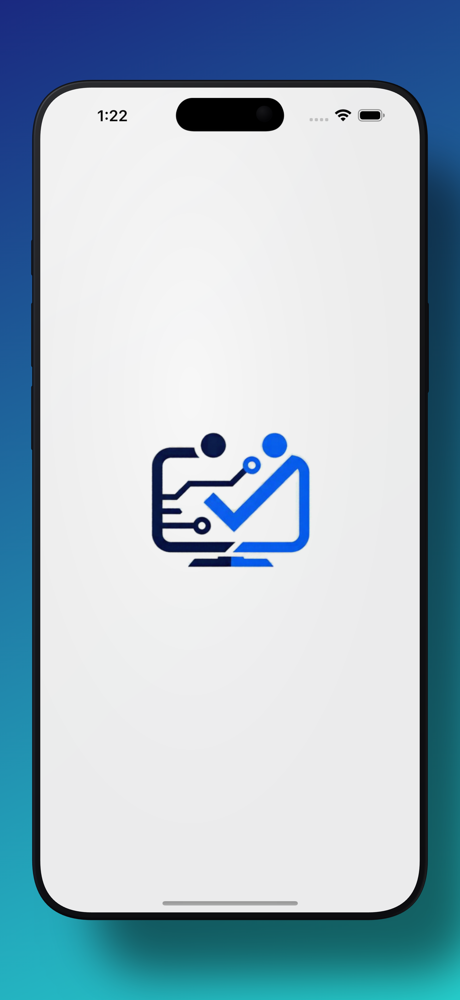 | 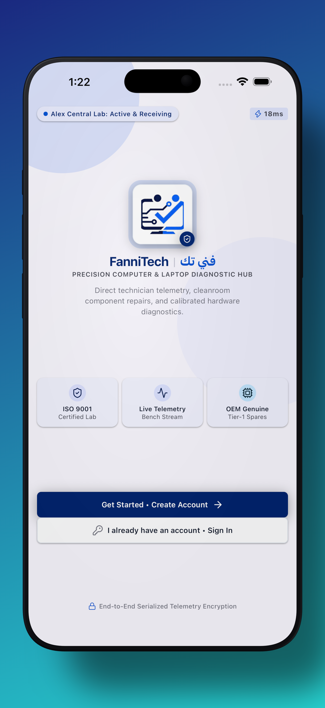 | 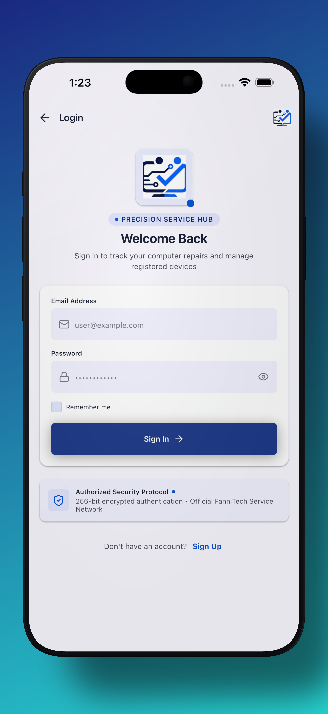 | 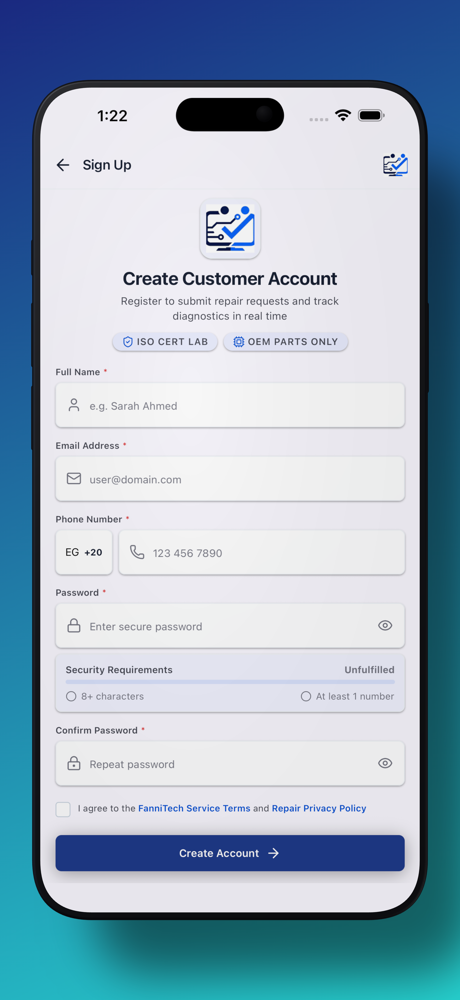 |

| 5. Home Dashboard | 6. My Devices | 7. Add Device | 8. Repair Request |
| :---: | :---: | :---: | :---: |
| 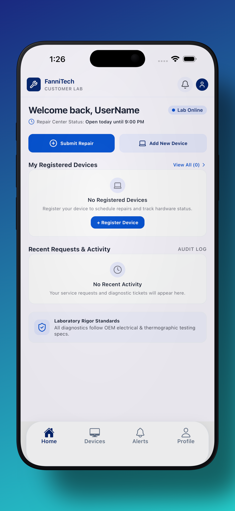 | 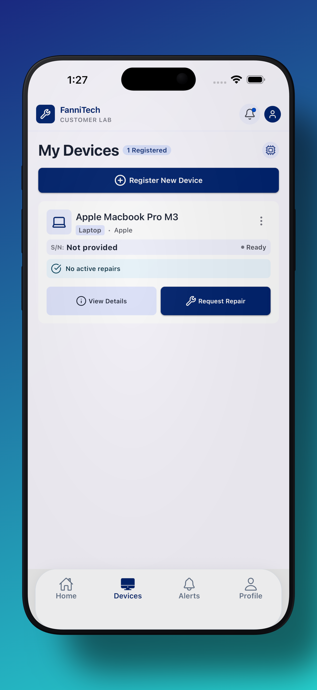 | 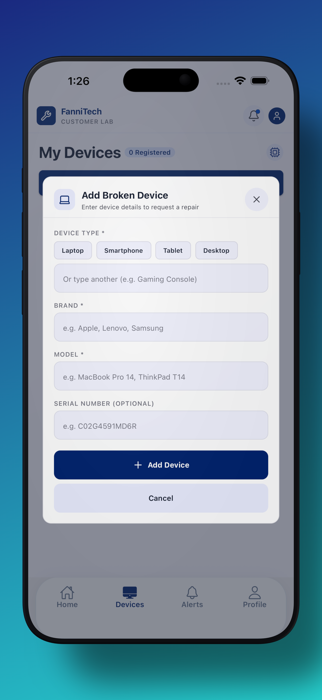 | 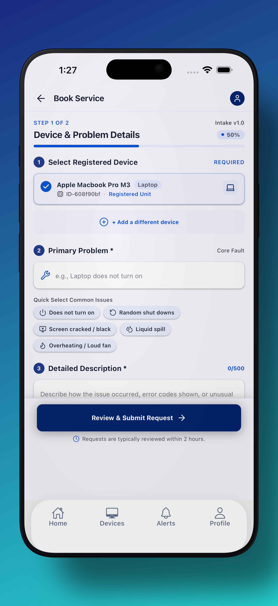 |

| 9. Repair Ticket | 10. Alerts | 11. Profile |
| :---: | :---: | :---: |
| 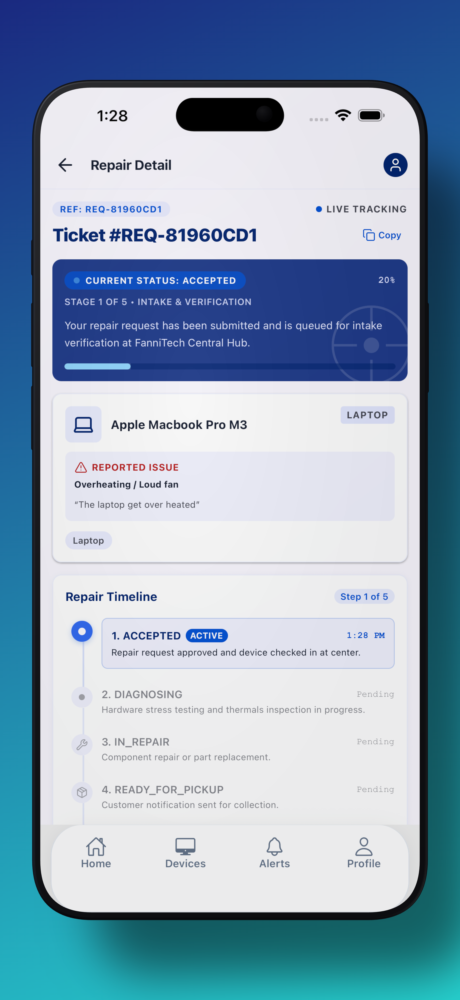 | 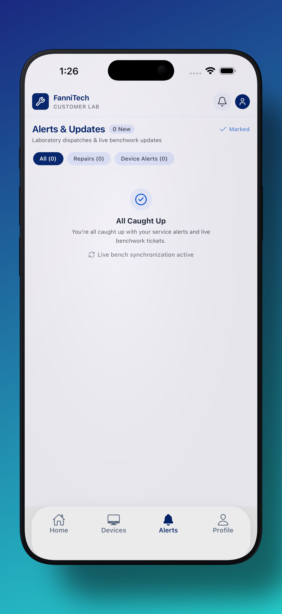 | 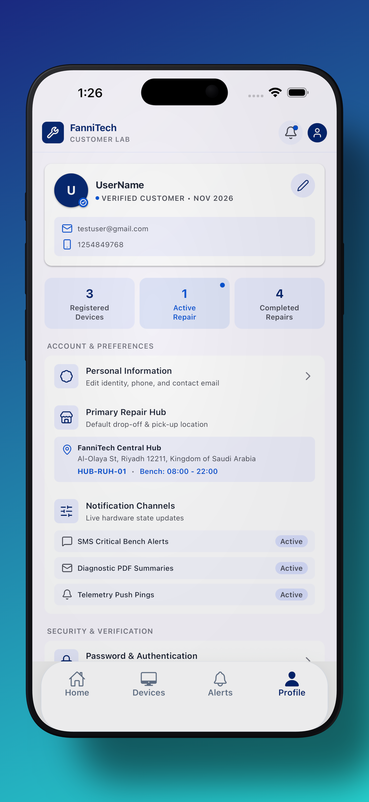 |

---

## V1 MVP Scope & Feature Capabilities

V1 focuses on the core single-shop repair lifecycle and customer engagement:

- **Identity, RBAC & Multi-Client Auth**: Unified authentication with 1:1 role profiles (`Customer`, `Admin`, `Technician`), Role-Based Access Control (RBAC), and rotating `RefreshToken` families (`WEB` HTTP-only cookies & `MOBILE` SecureStore).
- **Customer Device Registry**: Customers manage hardware profiles (Device Type, Brand, Model, Serial Number) with a responsive bottom-sheet registration flow.
- **Repair Request Intake & Media**: Customer issue submission with Cloudinary image attachments and admin triage workflow (`PENDING` $\to$ `ACCEPTED`, `REJECTED`, or `CANCELLED`).
- **Ticket Lifecycle Management**: Accepted requests auto-convert into tracked repair tickets (`TK-YYYY-XXXX`) with priority levels (`LOW`, `MEDIUM`, `HIGH`).
- **Technician Workbench**: Assignment queue with technical logging for diagnostic reports and repair work notes.
- **Audit Logging**: Mandatory, immutable status history recording on every ticket state update.
- **Real-Time & Push Notifications**: Live Socket.IO event updates and Expo push / in-app alerts triggered by ticket state transitions.
- **Responsive Mobile UI**: Adaptive layouts across mobile screen sizes using shared responsive scaling utilities (`useResponsive`).

---

## Multi-Version Roadmap

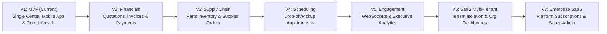

---

## System Architecture & Tech Stack

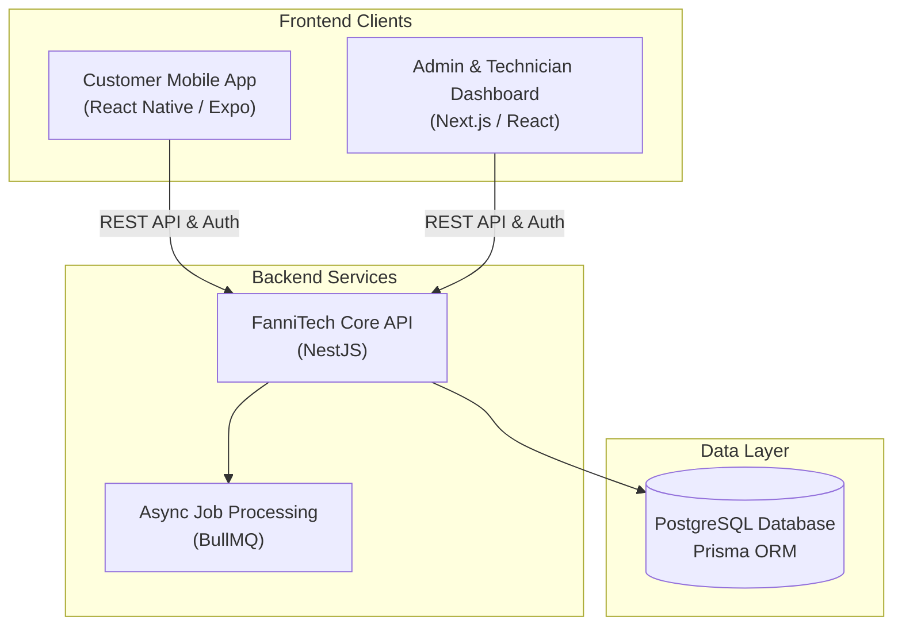

### Technology Matrix

| Layer | Technologies |
| :--- | :--- |
| **Backend API** (`server/`) | [NestJS](https://nestjs.com/), TypeScript, [Prisma ORM](https://www.prisma.io/) (`@prisma/adapter-pg`), PostgreSQL, Socket.IO, BullMQ, Cloudinary, Helmet, Swagger (`/docs`), Vitest, Oxlint |
| **Web Dashboard** (`web/`) | [Next.js](https://nextjs.org/) (App Router), React 19, Tailwind CSS v4, Shadcn UI / Base UI, Zustand, SWR, Axios, Socket.IO Client, Vercel Analytics & Speed Insights |
| **Mobile App** (`mobile/`) | [React Native](https://reactnative.dev/), [Expo](https://expo.dev/) (Expo Router), NativeWind, TanStack Query, Zustand, React Hook Form, Socket.IO Client, Expo Notifications, Image Picker, SecureStore, Jest, EAS Build |

---

## Domain & Data Model

The V1 database schema uses a strictly normalized entity structure with user subtyping, token rotation, media attachments, and audit logging:

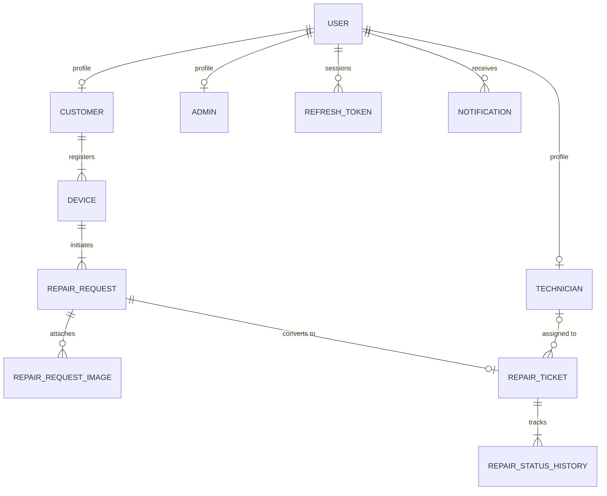

### Key Entities

- **`USER`**: Core authentication record (`id`, `email`, `name`, `password`, `phone`, `role`, `EmailVerifyAt`, timestamps).
- **`REFRESH_TOKEN`**: Rotating session tokens per client (`id`, `userId`, `familyId`, `client` [`WEB` / `MOBILE`], `deviceInfo`, `expiresAt`, `usedAt`, `revoke`).
- **`CUSTOMER`**: Profile details (`userId` FK, `notes`).
- **`ADMIN`**: Center management profile (`id` FK, `employeeId`).
- **`TECHNICIAN`**: Service staff profile (`id` FK, `employeeId`).
- **`DEVICE`**: Hardware registry (`id`, `customerId`, `deviceType`, `brand`, `model`, `serialNumber`).
- **`REPAIR_REQUEST`**: Intake problem record (`id`, `deviceId`, `problem`, `description`, `status`).
- **`REPAIR_REQUEST_IMAGE`**: Attached issue photos (`id`, `requestId`, `url`, `publicId`, `fileName`, `mimeType`, `size`).
- **`REPAIR_TICKET`**: Operational job (`id`, `requestId`, `technicianId`, `ticketNumber`, `priority`, `status`, `diagnosis`, `repairNotes`, `completedAt`).
- **`REPAIR_STATUS_HISTORY`**: Audit log of all status changes (`id`, `ticketId`, `status`, `notes`, `changedAt`).
- **`NOTIFICATION`**: User alerts (`id`, `userId`, `type`, `title`, `body`, `data`, `readAt`).

---

## Lifecycle Workflows & State Machines

### 1. Repair Request Lifecycle

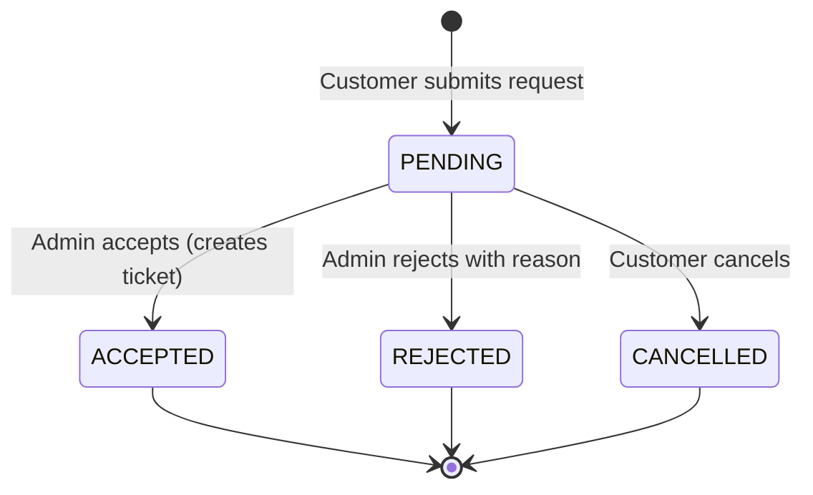

### 2. Repair Ticket Lifecycle

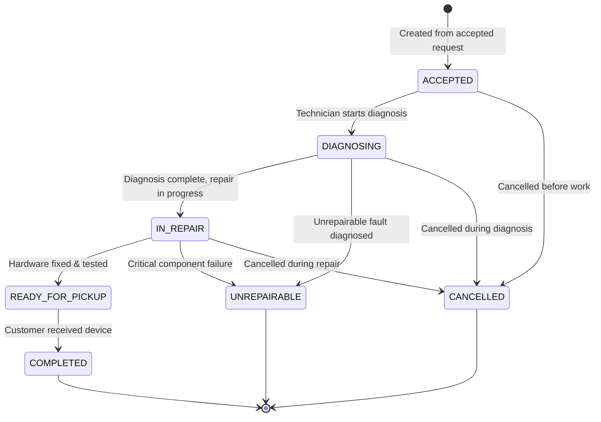

### 3. Transition Rules & Mandatory Triggers

| Current State | Target State | Authorized Actor | Automated Actions |
| :--- | :--- | :--- | :--- |
| `PENDING` | `ACCEPTED` | Admin | Generates `REPAIR_TICKET`, issues `ticket_number`, logs audit history, notifies customer. |
| `PENDING` | `REJECTED` | Admin | Stores rejection reason, updates request status, notifies customer. |
| `ACCEPTED` | `DIAGNOSING` | Technician / Admin | Validates technician assignment, logs history, updates ticket status. |
| `DIAGNOSING` | `IN_REPAIR` | Technician | Saves `diagnosis` report, logs status change, sends status notification. |
| `IN_REPAIR` | `READY_FOR_PICKUP` | Technician | Saves `repair_notes`, logs status change, sends pickup alert. |
| `READY_FOR_PICKUP` | `COMPLETED` | Admin / Technician | Sets `completed_at` timestamp, closes ticket, logs audit history. |
| *Active State* | `UNREPAIRABLE` | Technician / Admin | Records cause in `repair_notes`, logs state, triggers customer alert. |
| *Active State* | `CANCELLED` | Admin / Customer | Terminates repair job, records reason, updates audit history. |

---

## Project Structure

A modular multi-package repository containing backend, web dashboard, and mobile client codebases:

```
FanniTech/
├── .github/workflows/          # CI pipelines (lint, typecheck, unit & e2e tests)
├── AppPreview/                 # Mobile app screenshots for documentation
├── docs/                       # Architectural specifications & task implementation plans
│   ├── project-plan.md         # V1 Master Project Plan & System Architecture
│   └── tasks/                  # Feature implementation blueprints & guides
├── mobile/                     # Customer Mobile Application (React Native / Expo)
│   ├── assets/                 # App icons, splash screens, and image assets
│   ├── src/
│   │   ├── app/                # Expo Router screen declarations & navigation layouts
│   │   ├── components/         # Shared presentation & UI components
│   │   ├── features/           # Feature modules (auth, alerts, devices, home, profile)
│   │   ├── hooks/              # Responsive layout & shared hooks
│   │   └── utils/              # API client & responsive scaling utilities
│   ├── app.json                # Expo configuration
│   ├── eas.json                # EAS Build profiles (development, preview, production)
│   └── package.json            # Mobile dependencies & run scripts
├── server/                     # Backend API & Domain Services (NestJS)
│   ├── prisma/                 # Prisma database schema, migrations & seed scripts
│   ├── src/
│   │   ├── admin-dashboard/    # Center administration endpoints & services
│   │   ├── authentication/     # JWT authentication, guards & user subtyping logic
│   │   ├── devices/            # Device registration and management
│   │   ├── notifications/      # Socket.IO & notification dispatching engine
│   │   ├── repair-request-managment/ # Admin repair request triage & ticket conversion
│   │   ├── repair-requests/    # Customer request submission & handling
│   │   ├── storage/            # Cloudinary media upload & storage integration
│   │   ├── technician-dashboard/# Technician queue & ticket progression
│   │   └── main.ts             # Application bootstrap & configuration
│   ├── test/                   # Integration and end-to-end test suites
│   ├── Dockerfile              # Container build configuration
│   ├── prisma.config.ts        # Prisma configuration
│   └── package.json            # Server dependencies & run scripts
├── web/                        # Repair Center Web Dashboard (Next.js)
│   ├── public/                 # Static web assets
│   ├── src/
│   │   ├── app/                # Next.js App Router pages and layouts
│   │   ├── components/         # UI components & design system primitives
│   │   ├── Hooks/              # Custom React hooks
│   │   ├── Portal/             # Role-based dashboard interfaces
│   │   └── services/           # Backend API & Socket.IO integration clients
│   └── package.json            # Web dependencies & run scripts
├── LICENSE                     # Proprietary view-only license
└── README.md                   # Project documentation
```

---

## Getting Started

### Prerequisites

- **Node.js**: `v20.x` or higher
- **Package Manager**: `npm` (or `pnpm` / `yarn`)
- **Database**: PostgreSQL `15+`
- **Mobile Development**: [Expo Go](https://expo.dev/go) on iOS/Android or local simulator

---

### 1. Server Setup (Backend API)

```bash
# Navigate to the server workspace
cd server

# Install dependencies
npm install

# Configure environment variables
# Define: DATABASE_URL, JWT_SECRET, WEB_URL, PORT (defaults to 8080), etc. in your .env

# Run database migrations and generate Prisma client
npx prisma migrate dev
npx prisma db seed

# Start server in development mode
npm run start:dev
```

The server initializes by default on `http://localhost:8080` with Swagger API docs at `http://localhost:8080/docs` (OpenAPI JSON at `http://localhost:8080/docs/openapi.json`).

---

### 2. Web Setup (Admin & Technician Dashboard)

```bash
# Navigate to the web workspace
cd web

# Install dependencies
npm install

# Configure environment variables (e.g. NEXT_PUBLIC_API_URL) in .env

# Start Next.js development server
npm run dev
```

Open [http://localhost:3000](http://localhost:3000) in your browser.

---

### 3. Mobile Setup (Customer Mobile Application)

```bash
# Navigate to the mobile workspace
cd mobile

# Install dependencies
npm install

# Configure environment variables (e.g. EXPO_PUBLIC_API_URL) in .env

# Start Expo development server
npx expo start
```

Scan the QR code with **Expo Go** (Android) or the **Camera app** (iOS) to launch the app on your physical device or simulator.

---

## Architectural & Implementation Rules

All development within FanniTech follows the architectural standards defined in `docs/project-plan.md`:

1. **Relational Normalization**: Resolve device and customer details via joins (`REPAIR_TICKET` $\to$ `REPAIR_REQUEST` $\to$ `DEVICE` $\to$ `CUSTOMER`) rather than duplicating columns.
2. **User Identity Subtyping**: Store base auth credentials in `USER`. Do not create separate login tables for customers, technicians, and admins.
3. **State Machine Strictness**: State transitions must strictly follow the transition rules. Direct state jumps (e.g. bypassing ticket creation or diagnosis) are prohibited.
4. **Audit Consistency**: Every change to a ticket's status must atomically create a record in `REPAIR_STATUS_HISTORY`.
5. **Clean Version Boundary**: Adhere strictly to V1 requirements; defer multi-tenancy, billing, quotations, and parts inventory to future roadmap versions (V2–V7).

---

## License

**All Rights Reserved — Preview Only.**  
This project is proprietary. You may view and preview the repository for evaluation or portfolio review only; using, copying, modifying, distributing, or deploying any part of this codebase without prior written permission is prohibited. See [LICENSE](LICENSE) for full terms.
