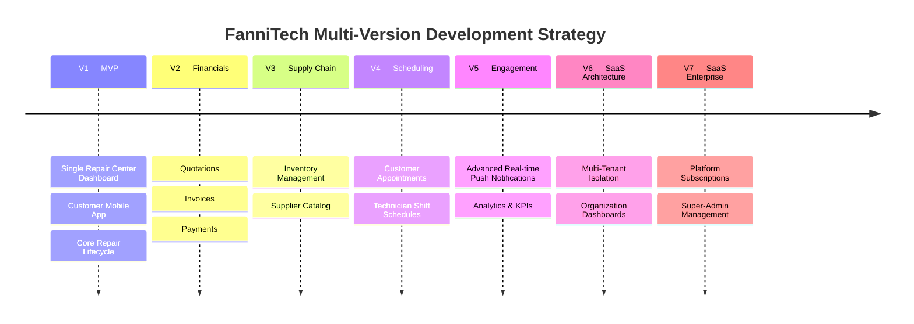
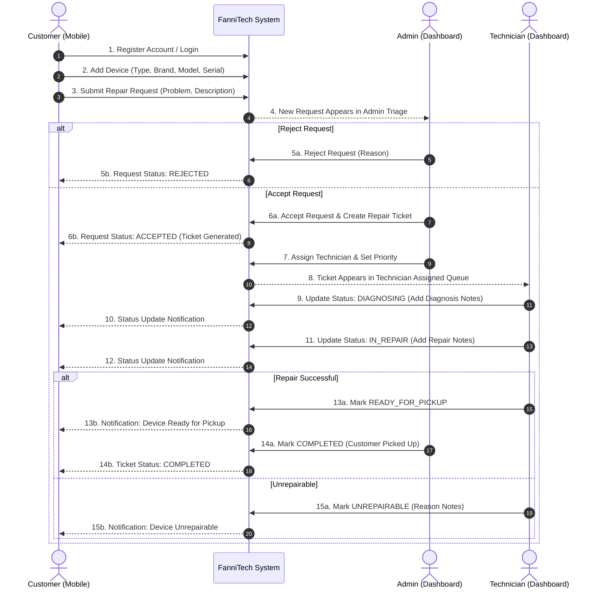
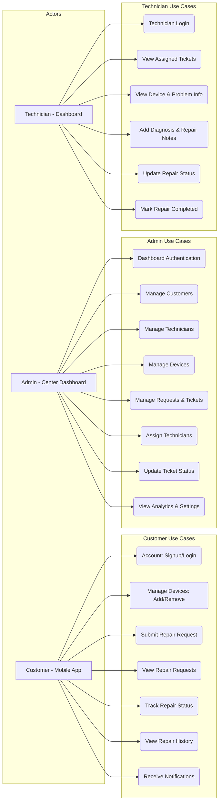
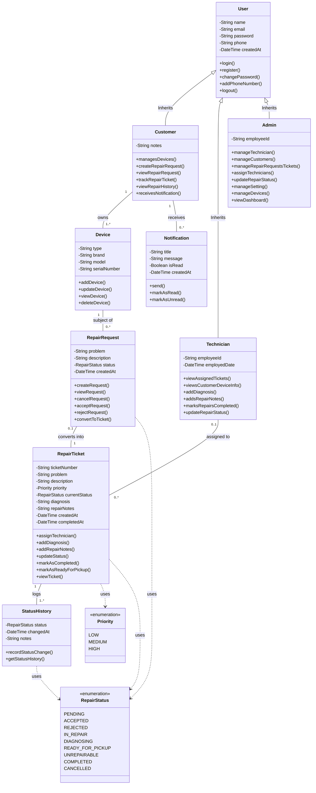
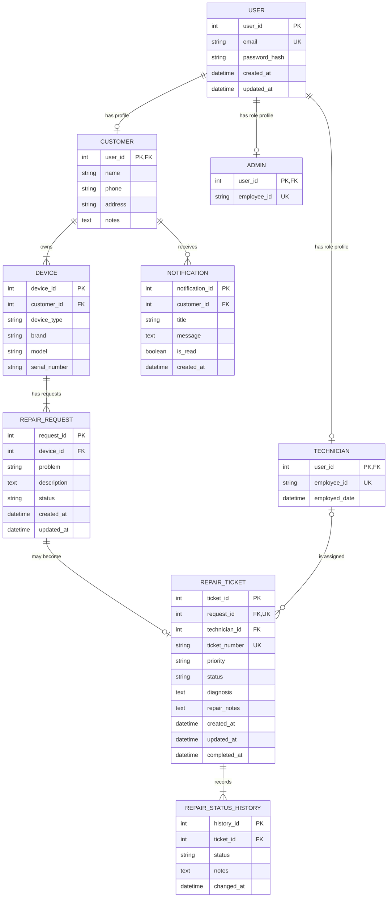
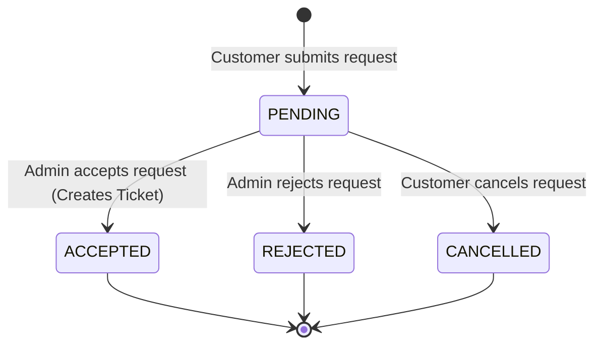
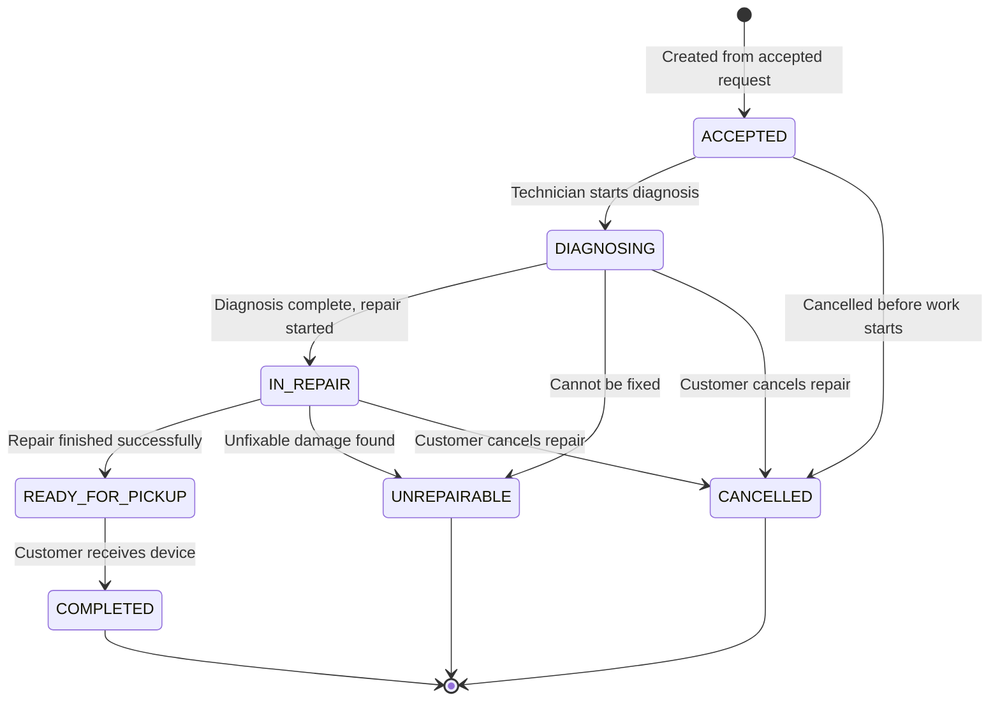
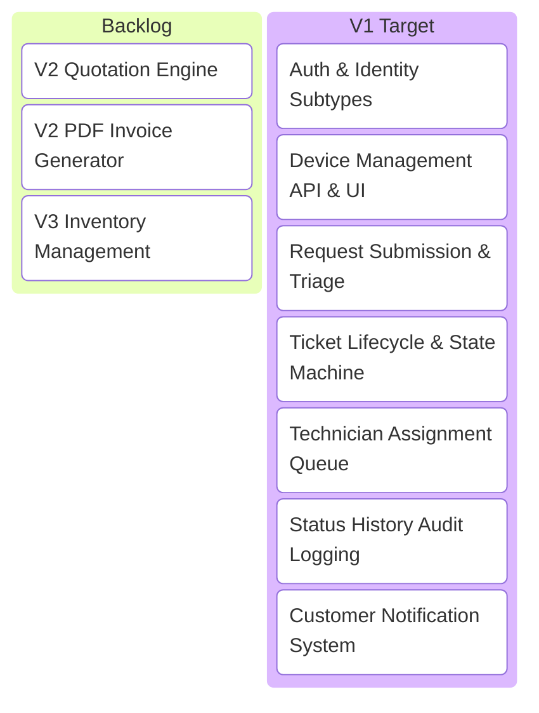

# FanniTech (فني تك) — Master Project Plan & System Architecture

> **Document Version**: 1.0.0  
> **Target Scope**: V1 Single Repair Center MVP + Customer Mobile Application  
> **Audience**: AI Coding Agents, Software Architects, and Full-Stack Developers  

---

## 1. AI Agent Execution Directive & Guidance

This document is the **single authoritative source of truth** for the design, architecture, data model, business logic, and implementation of **FanniTech**. When planning or writing code for FanniTech, all AI agents **MUST** follow these core guidelines:

1. **Strict Data Normalization**:
   - Customer and Device details on tickets/requests MUST be resolved via relational joins (`REPAIR_TICKET` $\to$ `REPAIR_REQUEST` $\to$ `DEVICE` $\to$ `CUSTOMER`) rather than duplicating foreign keys on `REPAIR_TICKET`, unless snapshot tables are explicitly required.
2. **User Identity Subtyping**:
   - All authentication credentials (`email`, `password_hash`) and core timestamps reside in `USER`.
   - Role-specific attributes belong in subtype tables (`CUSTOMER`, `ADMIN`, `TECHNICIAN`) linked via 1:1 foreign keys matching `USER.user_id`.
3. **State Machine Integrity**:
   - Status transitions MUST strictly follow the defined state transition rules. Invalid state jumps (e.g., from `PENDING` directly to `COMPLETED` without ticket creation) are strictly prohibited.
4. **Audit History Enforcement**:
   - Any modification to `REPAIR_TICKET.status` MUST atomically generate a `REPAIR_STATUS_HISTORY` record.
5. **V1 Scope Boundary**:
   - Do NOT implement multi-tenancy, SaaS billing, quotation calculations, or inventory tracking in V1 code unless explicitly prompted. Build V1 to be easily extensible for V2–V7.

---

## 2. Product Vision & Multi-Version Roadmap

FanniTech is a computer repair center management platform designed to connect computer repair centers, technicians, and customers through a unified workflow.



### Detailed Roadmap Overview

| Version | Target Feature Scope | Platform Focus |
| :--- | :--- | :--- |
| **V1 (Current)** | Single Repair Center Management, Customer Mobile App, Device Inventory, Request Submission, Ticket Lifecycle, Status Tracking, Technician Assignment, Status History. | Web Dashboard + Mobile App |
| **V2** | Quotation Generation, PDF Invoicing, Online/Offline Payment Gateways. | Web + Mobile |
| **V3** | Spare Parts Inventory Management, Stock Alerts, Supplier Profiles & Purchase Orders. | Repair Center Web |
| **V4** | Drop-off / Pickup Appointment Scheduling, Calendar Integration. | Web + Mobile |
| **V5** | Real-time WebSockets / Push Notifications, Executive Analytics & Repair Metrics. | Web + Mobile |
| **V6** | Multi-Tenant Database Architecture, Repair Center Onboarding, Organization Isolation. | Backend Platform |
| **V7** | Tenant Subscription Billing, Super-Admin Portal, Platform Metrics. | SaaS Admin Portal |

---

## 3. Core Business Rules & Domain Workflow

### 3.1 Entity Relationship Rules
1. **Customer & Devices**: A Customer owns 1 or more Devices (`1 : N`). Each Device is tied to exactly 1 Customer.
2. **Device & Repair Requests**: A Device can have multiple Repair Requests over its lifetime (`1 : N`). Each Repair Request belongs to 1 Device.
3. **Repair Request & Repair Ticket**: A Repair Request can be accepted by the repair center to become a Repair Ticket (`1 : 0..1`). A pending, rejected, or cancelled request does not produce a ticket.
4. **Technician & Repair Ticket**: A Repair Ticket can be assigned to 0 or 1 Technician at a time (`0..1 : N`). A Technician can manage multiple active tickets.
5. **Ticket & Status History**: A Repair Ticket maintains a complete record of status changes (`1 : N`).

### 3.2 End-to-End Operational Lifecycle Workflow



---

## 4. Use Case Specifications & Actor Matrix

Derived directly from system use cases:

```mermaid
useCaseDiagram
```



### Detailed Actor Responsibilities

| Actor | Access Channel | Core Responsibilities | Key Capabilities |
| :--- | :--- | :--- | :--- |
| **Customer** | Mobile App (iOS / Android) | Device owner submitting & tracking repair jobs. | Create account, add/remove devices, submit repair requests, view request status, track real-time repair progress, view repair history, receive push notifications. |
| **Admin** | Repair Center Web Dashboard | Center owner / manager overseeing operations. | Manage technicians and customer profiles, triage repair requests, create tickets, assign technicians, adjust ticket priorities, override ticket statuses, view dashboard metrics. |
| **Technician** | Web Dashboard / Mobile View | Service technician repairing hardware. | View queue of assigned tickets, inspect device specs & customer problem description, add technical diagnosis, record repair progress notes, transition ticket statuses, mark repairs ready/completed. |

---

## 5. Domain Class Diagram & Object Model

Below is the complete domain model mapping all attributes, methods, enumerations, and relationships:



---

## 6. Database Architecture & ERD Guidance

### 6.1 Entity-Relationship Diagram (Mermaid ERD)



### 6.2 Relational Data Dictionary

#### 1. `USER`
Stores shared account credentials and authentication data.
* `user_id` (PK, Integer, Auto-Increment)
* `email` (String, Unique, Not Null)
* `password_hash` (String, Not Null)
* `created_at` (Timestamp, Default CURRENT_TIMESTAMP)
* `updated_at` (Timestamp, Default CURRENT_TIMESTAMP)

#### 2. `CUSTOMER`
Profile table for customer-specific information.
* `user_id` (PK, FK $\to$ `USER.user_id`, Integer)
* `name` (String, Not Null)
* `phone` (String, Not Null)
* `address` (String, Nullable)
* `notes` (Text, Nullable)

#### 3. `ADMIN`
Profile table for administrative staff.
* `user_id` (PK, FK $\to$ `USER.user_id`, Integer)
* `employee_id` (String, Unique, Not Null)

#### 4. `TECHNICIAN`
Profile table for repair technician staff.
* `user_id` (PK, FK $\to$ `USER.user_id`, Integer)
* `employee_id` (String, Unique, Not Null)
* `employed_date` (Date, Nullable)

#### 5. `DEVICE`
Hardware devices registered by customers.
* `device_id` (PK, Integer, Auto-Increment)
* `customer_id` (FK $\to$ `CUSTOMER.user_id`, Integer, Not Null)
* `device_type` (String, e.g., "Laptop", "Desktop", "Tablet")
* `brand` (String, e.g., "Apple", "Dell", "Lenovo")
* `model` (String, e.g., "MacBook Pro 16", "XPS 15")
* `serial_number` (String, Nullable)

#### 6. `REPAIR_REQUEST`
Customer-submitted requests describing issue symptoms.
* `request_id` (PK, Integer, Auto-Increment)
* `device_id` (FK $\to$ `DEVICE.device_id`, Integer, Not Null)
* `problem` (String, Summary of problem)
* `description` (Text, Detailed customer notes)
* `status` (Enum/String: `PENDING`, `ACCEPTED`, `REJECTED`, `CANCELLED`)
* `created_at` (Timestamp, Default CURRENT_TIMESTAMP)
* `updated_at` (Timestamp, Default CURRENT_TIMESTAMP)

#### 7. `REPAIR_TICKET`
Active repair job managed by the repair center.
* `ticket_id` (PK, Integer, Auto-Increment)
* `request_id` (FK $\to$ `REPAIR_REQUEST.request_id`, Unique, Not Null)
* `technician_id` (FK $\to$ `TECHNICIAN.user_id`, Nullable)
* `ticket_number` (String, Unique, e.g., "TK-2026-0001")
* `priority` (Enum/String: `LOW`, `MEDIUM`, `HIGH`, Default `MEDIUM`)
* `status` (Enum/String: `ACCEPTED`, `DIAGNOSING`, `IN_REPAIR`, `READY_FOR_PICKUP`, `COMPLETED`, `REJECTED`, `CANCELLED`, `UNREPAIRABLE`)
* `diagnosis` (Text, Nullable)
* `repair_notes` (Text, Nullable)
* `created_at` (Timestamp, Default CURRENT_TIMESTAMP)
* `updated_at` (Timestamp, Default CURRENT_TIMESTAMP)
* `completed_at` (Timestamp, Nullable)

#### 8. `REPAIR_STATUS_HISTORY`
Audit log of all ticket state transitions.
* `history_id` (PK, Integer, Auto-Increment)
* `ticket_id` (FK $\to$ `REPAIR_TICKET.ticket_id`, Integer, Not Null)
* `status` (String, State entered)
* `notes` (Text, Optional context note)
* `changed_at` (Timestamp, Default CURRENT_TIMESTAMP)

#### 9. `NOTIFICATION`
In-app and push notifications for customers.
* `notification_id` (PK, Integer, Auto-Increment)
* `customer_id` (FK $\to$ `CUSTOMER.user_id`, Integer, Not Null)
* `title` (String, Not Null)
* `message` (Text, Not Null)
* `is_read` (Boolean, Default FALSE)
* `created_at` (Timestamp, Default CURRENT_TIMESTAMP)

---

## 7. State Machines & Status Transition Matrix

### 7.1 Repair Request State Machine



### 7.2 Repair Ticket State Machine



### 7.3 Status Transition Matrix & Triggers

| Current State | Target State | Permitted Role | Mandatory Actions & Side Effects |
| :--- | :--- | :--- | :--- |
| `PENDING` | `ACCEPTED` | Admin | Creates `REPAIR_TICKET`, generates `ticket_number`, logs `REPAIR_STATUS_HISTORY`, notifies Customer. |
| `PENDING` | `REJECTED` | Admin | Updates request status, logs rejection reason, notifies Customer. |
| `PENDING` | `CANCELLED` | Customer | Updates request status. |
| `ACCEPTED` | `DIAGNOSING` | Technician / Admin | Assigns technician if unassigned, updates ticket state, logs history. |
| `DIAGNOSING` | `IN_REPAIR` | Technician | Saves `diagnosis` text, updates ticket state, logs history, notifies Customer. |
| `IN_REPAIR` | `READY_FOR_PICKUP` | Technician | Saves `repair_notes`, updates state, logs history, sends push notification to Customer. |
| `READY_FOR_PICKUP` | `COMPLETED` | Admin / Technician | Sets `completed_at` timestamp, updates status to `COMPLETED`, logs history. |
| *Any Active State* | `UNREPAIRABLE` | Technician / Admin | Saves cause in `repair_notes`, updates state, logs history, notifies Customer. |
| *Any Active State* | `CANCELLED` | Admin / Customer | Updates state, logs history, sets completion timestamp. |

---

## 8. V1 MVP Implementation Readiness Matrix

The following modules constitute the target baseline for V1 development:



### Functional Component Summary

1. **Authentication & Identity Service**:
   - JWT or Session-based authentication for `User`.
   - Role-Based Access Control (RBAC) middleware for `Customer`, `Admin`, and `Technician`.
2. **Customer Mobile Application**:
   - Device CRUD operations.
   - Repair request wizard (select device $\to$ input problem/description $\to$ submit).
   - Real-time ticket tracking dashboard & history list.
3. **Repair Center Admin Dashboard**:
   - Live incoming request queue.
   - Ticket generator modal with technician assignment and priority picker.
   - Customer and technician directory views.
4. **Technician Workspace**:
   - Mobile/Desktop view filtered by `technician_id`.
   - Rich text input for Diagnosis and Repair Notes.
   - One-click state transition buttons with automatic history logging.
5. **Notification Engine**:
   - In-app notification dispatcher linked to state transition events.

---

## 9. Verification & Architectural Compliance

When delivering code or verifying implementation for FanniTech V1:

- **Database Foreign Keys**: Run migration scripts to verify constraints on `user_id` subtypes, `device_id`, `request_id`, and `technician_id`.
- **State Transition Unit Tests**: Assert that attempting invalid transitions (e.g. `PENDING` directly to `COMPLETED`) throws explicit domain validation errors.
- **Audit Consistency**: Assert that every update to `REPAIR_TICKET.status` creates a corresponding row in `REPAIR_STATUS_HISTORY`.
- **No Orphan Records**: Verify cascading deletes or soft-delete flags for devices and requests so user records remain intact.
