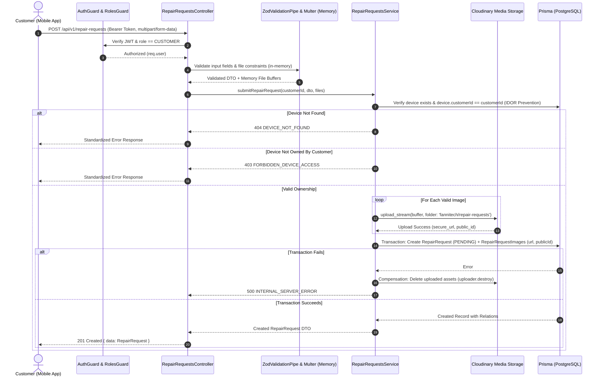

# Implementation Plan: Customer Repair Request Submission (Backend)

## Goal Description
Implement the complete backend feature for customers to submit repair requests for their devices via their mobile application. A customer can submit issue details (summary problem & detailed description) and attach images from their mobile app.
Images will be uploaded via `multipart/form-data`, validated, and streamed directly to **Cloudinary** cloud media storage (no local filesystem storage), with references (secure CDN URL, Cloudinary `publicId`, size, MIME type) persisted in the database via Prisma. The implementation aligns strictly with the master project specification ([project-plan.md](../project-plan.md)), adhering to the `back-end-api-development` and `security-skill` guidelines.

---

## User Review Required

> [!IMPORTANT]
> **Cloud Storage Integration (Cloudinary)**:
> - No images are stored on the server's local filesystem.
> - Images uploaded via `multipart/form-data` are buffered in memory (`multer.memoryStorage()`), strictly validated (MIME type whitelist, max size, max file count), and uploaded directly to Cloudinary using the official `cloudinary` SDK via stream upload (`fannitech/repair-requests` folder).
> - Database table `RepairRequestImage` stores the Cloudinary `publicId` and `url` (`secure_url`) alongside image metadata.
> - If database insertion fails, compensation logic calls Cloudinary `uploader.destroy(...)` to prevent orphaned media.

> [!IMPORTANT]
> **Database Schema Extension**:
> - Extends `schema.prisma` with `Customer` (1:1 with `User`), `Device`, `RepairRequest`, and `RepairRequestImage`.
> - Maintains strict data normalization and user identity subtyping from [project-plan.md](../project-plan.md).

---

## Architecture & Data Flow



---

## Proposed Changes

Grouped by component layer, ordered by dependency flow.

---

### 1. Dependencies & Environment Configuration

#### [MODIFY] [server/package.json](../../server/package.json)
- Add `cloudinary` (official Cloudinary Node.js SDK).
- Add `@types/multer` to `devDependencies` for Multer buffer type safety.

#### [MODIFY] [server/.env](../../server/.env)
Add environment variables for Cloudinary:
```env
# Cloudinary Media Storage
CLOUDINARY_CLOUD_NAME=your_cloud_name
CLOUDINARY_API_KEY=your_api_key
CLOUDINARY_API_SECRET=your_api_secret
```

---

### 2. Database & Prisma Schema

Extend `schema.prisma` according to [project-plan.md](../project-plan.md).

#### [MODIFY] [server/prisma/schema.prisma](../../server/prisma/schema.prisma)

- Add 1:1 relation from `User` to `Customer`.
- Add `Customer` profile model.
- Add `Device` model with relation to `Customer`.
- Add `RepairRequest` model with `RepairRequestStatus` enum (`PENDING`, `ACCEPTED`, `REJECTED`, `CANCELLED`).
- Add `RepairRequestImage` model storing Cloudinary URL and publicId:

```prisma
enum RepairRequestStatus {
  PENDING
  ACCEPTED
  REJECTED
  CANCELLED
}

model Customer {
  userId    String         @id
  user      User           @relation(fields: [userId], references: [id], onDelete: Cascade)
  notes     String?
  devices   Device[]
  createdAt DateTime       @default(now())
  updatedAt DateTime       @updatedAt
}

model Device {
  id             String          @id @default(uuid())
  customerId     String
  customer       Customer        @relation(fields: [customerId], references: [userId], onDelete: Cascade)
  deviceType     String
  brand          String
  model          String
  serialNumber   String?
  repairRequests RepairRequest[]
  createdAt      DateTime        @default(now())
  updatedAt      DateTime        @updatedAt

  @@index([customerId])
}

model RepairRequest {
  id          String               @id @default(uuid())
  deviceId    String
  device      Device               @relation(fields: [deviceId], references: [id], onDelete: Cascade)
  problem     String
  description String
  status      RepairRequestStatus  @default(PENDING)
  images      RepairRequestImage[]
  createdAt   DateTime             @default(now())
  updatedAt   DateTime             @updatedAt

  @@index([deviceId])
  @@index([status])
}

model RepairRequestImage {
  id        String        @id @default(uuid())
  requestId String
  request   RepairRequest @relation(fields: [requestId], references: [id], onDelete: Cascade)
  url       String
  publicId  String
  fileName  String
  mimeType  String
  size      Int
  createdAt DateTime      @default(now())

  @@index([requestId])
}
```

---

### 3. Common Security, Roles, & Error Standardization

#### [NEW] [server/src/common/guards/roles.guard.ts](../../server/src/common/guards/roles.guard.ts)
- Guard inspecting `@Roles(...)` metadata and ensuring authenticated `req.user.role === 'CUSTOMER'`.

#### [NEW] [server/src/common/decorators/roles.decorator.ts](../../server/src/common/decorators/roles.decorator.ts)
- `@Roles('CUSTOMER', 'ADMIN', 'TECHNICIAN')` decorator.

#### [NEW] [server/src/common/filters/http-exception.filter.ts](../../server/src/common/filters/http-exception.filter.ts)
- Unifies all application errors to the standard format required by `back-end-api-development`:
  ```json
  {
    "error": {
      "code": "ERROR_CODE",
      "message": "Human readable message",
      "details": {}
    }
  }
  ```

---

### 4. Cloudinary Cloud Media Storage Module

#### [NEW] [server/src/storage/storage.service.ts](../../server/src/storage/storage.service.ts)
- Configures `cloudinary.v2.config` with credentials from `ConfigService`.
- **Validation**:
  - Whitelist: `image/jpeg`, `image/png`, `image/webp`.
  - Max size: 5MB per file.
  - Max files: 5 images.
- **Upload**:
  - Takes in-memory file buffer (`Express.Multer.File`).
  - Streams buffer to Cloudinary using `cloudinary.v2.uploader.upload_stream({ folder: 'fannitech/repair-requests', resource_type: 'image' })`.
  - Resolves `{ url: result.secure_url, publicId: result.public_id }`.
- **Cleanup / Rollback**:
  - `deleteImages(publicIds: string[])`: deletes uploaded assets using `cloudinary.v2.uploader.destroy(publicId)` if downstream database transaction fails.

#### [NEW] [server/src/storage/storage.module.ts](../../server/src/storage/storage.module.ts)
- Exports `StorageService` for feature modules.

---

### 5. Device Management (Prerequisite for Requests)

#### [NEW] [server/src/devices/dto/device.dto.ts](../../server/src/devices/dto/device.dto.ts)
- Zod schema for device registration: `deviceType`, `brand`, `model`, optional `serialNumber`.

#### [NEW] [server/src/devices/devices.service.ts](../../server/src/devices/devices.service.ts)
- `createDevice(customerId, dto)`: ensures `Customer` profile exists, creates device under `customerId`.
- `getCustomerDevices(customerId, query)`: lists devices owned by customer.
- `getDeviceById(customerId, deviceId)`: fetches device verifying ownership.

#### [NEW] [server/src/devices/devices.controller.ts](../../server/src/devices/devices.controller.ts)
- `POST /api/v1/devices`: Register new device.
- `GET /api/v1/devices`: List authenticated customer devices.

#### [NEW] [server/src/devices/devices.module.ts](../../server/src/devices/devices.module.ts)
- Exports `DevicesService`.

---

### 6. Repair Requests Feature Module

#### [NEW] [server/src/repair-requests/dto/create-repair-request.dto.ts](../../server/src/repair-requests/dto/create-repair-request.dto.ts)
- Zod schema validating:
  - `deviceId`: UUID string.
  - `problem`: string (min 3, max 150).
  - `description`: string (min 10, max 2000).

#### [NEW] [server/src/repair-requests/dto/repair-request-query.dto.ts](../../server/src/repair-requests/dto/repair-request-query.dto.ts)
- Query parameters schema:
  - `page`: positive integer (default 1).
  - `limit`: integer between 1 and 50 (default 10).
  - `status`: optional enum (`PENDING`, `ACCEPTED`, `REJECTED`, `CANCELLED`).

#### [NEW] [server/src/repair-requests/repair-requests.service.ts](../../server/src/repair-requests/repair-requests.service.ts)
- `submitRequest(userId, dto, files: Express.Multer.File[])`:
  - Verify device exists. If not, throw `NotFoundException('Device not found')`.
  - Validate ownership: `device.customerId === userId`. If mismatch, throw `ForbiddenException('You do not own this device')`.
  - Upload images directly to Cloudinary via `StorageService`.
  - Execute Prisma transaction:
    - Create `RepairRequest` with status `PENDING`.
    - Create `RepairRequestImage` records (url, publicId, filename, mimeType, size).
  - If transaction fails, invoke `storageService.deleteImages(...)` to rollback uploaded files from Cloudinary.
  - Return created request with relations.
- `listCustomerRequests(userId, query)`:
  - Paginated list where `device.customerId === userId`.
- `getRequestDetails(userId, requestId)`:
  - Validate ownership `request.device.customerId === userId`.
  - Return details with images array.
- `cancelRequest(userId, requestId)`:
  - State machine check: Customer can only cancel from `PENDING`.
  - If status != `PENDING`, throw `ConflictException('Only pending requests can be cancelled')`.
  - Update status to `CANCELLED`.

#### [NEW] [server/src/repair-requests/repair-requests.controller.ts](../../server/src/repair-requests/repair-requests.controller.ts)
- `POST /api/v1/repair-requests`:
  - Protected with `AuthenticationGuard` and `@Roles('CUSTOMER')`.
  - Accepts `multipart/form-data` using `FilesInterceptor('images', 5, { storage: multer.memoryStorage(), limits: { fileSize: 5 * 1024 * 1024 } })`.
  - Returns 201 Created.
- `GET /api/v1/repair-requests`:
  - Returns paginated requests list for customer.
- `GET /api/v1/repair-requests/:id`:
  - Returns request details with Cloudinary image URLs.
- `PATCH /api/v1/repair-requests/:id/cancel`:
  - Cancels a pending request.

#### [NEW] [server/src/repair-requests/repair-requests.module.ts](../../server/src/repair-requests/repair-requests.module.ts)
- Wires controllers, services, Prisma, and Storage modules.

---

### 7. Swagger Documentation & App Configuration

#### [MODIFY] [server/src/swagger/swagger.schemas.ts](../../server/src/swagger/swagger.schemas.ts)
- Add schemas for `CreateRepairRequestMultipart` (with file upload spec), `RepairRequestResponse`, and `DeviceResponse`.

#### [MODIFY] [server/src/app.module.ts](../../server/src/app.module.ts)
- Import `StorageModule`, `DevicesModule`, and `RepairRequestsModule`.

#### [MODIFY] [server/src/main.ts](../../server/src/main.ts)
- Register global `HttpExceptionFilter`.

---

## Verification Plan

### Automated Tests
1. **Unit Tests (Vitest)**:
   - `storage.service.spec.ts`:
     - Test Cloudinary stream upload mock (`upload_stream` execution returning `secure_url` and `public_id`).
     - Test MIME type whitelist rejection (e.g. `.exe`, `.pdf`).
     - Test file size boundary limit (> 5MB throws `BadRequestException`).
     - Test rollback cleanup (`cloudinary.v2.uploader.destroy`).
   - `repair-requests.service.spec.ts`:
     - Successful submission without images.
     - Successful submission with 1-5 valid images uploaded to Cloudinary.
     - Device not found $\to$ 404 error.
     - Device owned by another customer $\to$ 403 error (IDOR protection).
     - State machine transition: cancel request from `PENDING` $\to$ success; cancel from `ACCEPTED` $\to$ 409 conflict.
     - Paginated list scoping: only returns requests for authenticated customer's devices.
   - `devices.service.spec.ts`:
     - Device creation and customer scoping.
2. **Execution Commands**:
   - `npm run test` (Vitest unit tests suite).
   - `npm run lint` (oxlint).
   - `npm run build` (TypeScript compiler validation).

### Manual Verification
1. Run `npm run start:dev`.
2. Open Swagger UI at `http://localhost:8080/docs`:
   - Authenticate with mobile customer JWT token.
   - Register a device via `POST /api/v1/devices`.
   - Submit a repair request via `POST /api/v1/repair-requests` using `multipart/form-data` with images.
   - Verify images are uploaded to Cloudinary and `secure_url` returned in response.
   - Retrieve request via `GET /api/v1/repair-requests/{id}` and check returned media URLs.
   - Cancel request via `PATCH /api/v1/repair-requests/{id}/cancel` and confirm status updates to `CANCELLED`.
