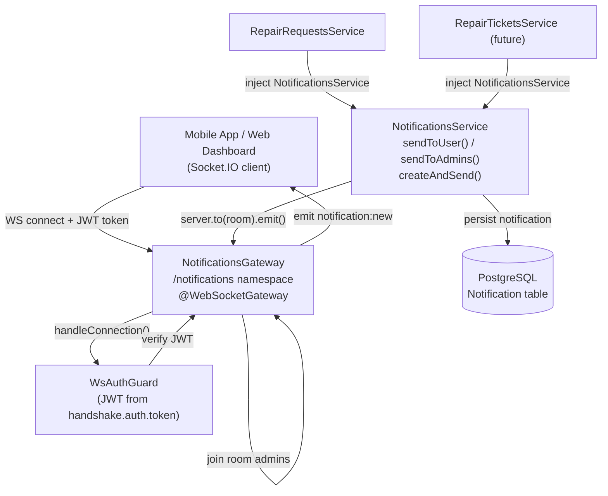

# Real-Time Notifications with WebSocket & Socket.IO

## Goal Description

Implement a **production-ready, fully authenticated real-time notification system** for FanniTech using the existing `@nestjs/websockets` + `socket.io` stack already installed in the project.

The feature is built entirely inside `src/notifications/` — no new modules, no new third-party libraries.

**What gets notified and to whom:**

| Trigger | Event | Target |
|---|---|---|
| Customer submits a repair request | `notification:new` — "Your repair request was received" | Customer (mobile) |
| Admin accepts a repair request | `notification:new` — "Your request has been accepted" | Customer (mobile) |
| Admin rejects a repair request | `notification:new` — "Your request has been rejected" | Customer (mobile) |
| Technician assigned to repair ticket | `notification:new` — "A technician has been assigned to your repair" | Customer (mobile) |
| Diagnostics completed | `notification:new` — "Diagnostics on your device are complete" | Customer (mobile) |
| Repair status updated (any workflow step) | `notification:new` — e.g. "Your device is now in repair" | Customer (mobile) |
| Repair ready for pickup | `notification:new` — "Your device is ready for pickup" | Customer (mobile) |
| Repair completed | `notification:new` — "Your repair has been completed" | Customer (mobile) |
| New repair request arrives at shop | `notification:new` — "New request from {name}" | All admins (web) |

---

## Architecture Overview



---

## Proposed Changes

---

### 1. Prisma — Database Schema

#### [MODIFY] `prisma/schema.prisma`

Add a `Notification` model and `NotificationType` enum:

```diff
+enum NotificationType {
+  REPAIR_REQUEST_RECEIVED
+  REPAIR_REQUEST_ACCEPTED
+  REPAIR_REQUEST_REJECTED
+  REPAIR_REQUEST_CANCELLED
+  TECHNICIAN_ASSIGNED
+  DIAGNOSTICS_COMPLETED
+  REPAIR_STATUS_UPDATED
+  REPAIR_READY_FOR_PICKUP
+  REPAIR_COMPLETED
+  NEW_REPAIR_REQUEST        // for admins
+}
+
+model Notification {
+  id        String           @id @default(uuid())
+  userId    String
+  user      User             @relation(fields: [userId], references: [id], onDelete: Cascade)
+  type      NotificationType
+  title     String
+  body      String
+  data      Json?            // extra payload, e.g. { repairRequestId }
+  readAt    DateTime?
+  createdAt DateTime         @default(now())
+
+  @@index([userId])
+  @@index([userId, readAt])  // optimise unread-count queries
+}
```

Also add the reverse relation on `User`:
```diff
 model User {
   ...
+  notifications Notification[]
 }
```

**Migration command:**
```bash
npx prisma migrate dev --name add_notifications_table
```

---

### 2. WebSocket Auth Guard

#### [NEW] `src/notifications/ws-auth.guard.ts`

A NestJS `CanActivate` that reads the JWT from the Socket.IO handshake.
Clients pass `{ auth: { token } }` during `io()` connect.

> **No `any` type** — `AuthenticatedSocket` interface is used throughout for full type safety.

```typescript
import { CanActivate, ExecutionContext, Injectable } from '@nestjs/common';
import { JwtService } from '@nestjs/jwt';
import { ConfigService } from '@nestjs/config';
import { WsException } from '@nestjs/websockets';
import { Socket } from 'socket.io';

interface SocketUser {
  id: string;
  role: string;
}

interface AuthenticatedSocket extends Socket {
  data: {
    user?: SocketUser;
  };
}

@Injectable()
export class WsAuthGuard implements CanActivate {
  constructor(
    private readonly jwt: JwtService,
    private readonly config: ConfigService,
  ) {}

  canActivate(ctx: ExecutionContext): boolean {
    const client = ctx.switchToWs().getClient<AuthenticatedSocket>();
    const token =
      client.handshake.auth?.token ??
      (client.handshake.headers?.authorization as string | undefined)?.replace(
        'Bearer ',
        '',
      );

    if (!token) throw new WsException('Unauthorized');

    try {
      const payload = this.jwt.verify<{ sub: string; role: string }>(token, {
        secret: this.config.getOrThrow<string>('ACCESS_TOKEN_SECRET'),
      });
      client.data.user = { id: payload.sub, role: payload.role };
      return true;
    } catch {
      throw new WsException('Unauthorized');
    }
  }
}
```

---

### 3. Notifications Gateway (full rewrite)

#### [MODIFY] `src/notifications/notifications.gateway.ts`

```typescript
import {
  OnGatewayConnection,
  OnGatewayDisconnect,
  OnGatewayInit,
  SubscribeMessage,
  WebSocketGateway,
  WebSocketServer,
} from '@nestjs/websockets';
import { UseGuards, Logger } from '@nestjs/common';
import { Server, Socket } from 'socket.io';
import { ConfigService } from '@nestjs/config';
import { JwtService } from '@nestjs/jwt';
import { WsAuthGuard } from './ws-auth.guard.js';

interface SocketUser {
  id: string;
  role: string;
}

interface AuthenticatedSocket extends Socket {
  data: {
    user?: SocketUser;
  };
}

@WebSocketGateway({
  namespace: '/notifications',
  cors: {
    origin: process.env['CORS_ORIGIN'] ?? '*',
    credentials: true,
  },
})
export class NotificationsGateway
  implements OnGatewayInit, OnGatewayConnection, OnGatewayDisconnect
{
  @WebSocketServer()
  server: Server;

  private readonly logger = new Logger(NotificationsGateway.name);

  constructor(
    private readonly jwt: JwtService,
    private readonly config: ConfigService,
  ) {}

  afterInit() {
    this.logger.log('Notifications WebSocket gateway initialized');
  }

  handleConnection(client: AuthenticatedSocket) {
    const token =
      client.handshake.auth?.token ??
      (client.handshake.headers?.authorization as string | undefined)?.replace(
        'Bearer ',
        '',
      );

    if (!token) {
      client.disconnect();
      return;
    }

    try {
      const payload = this.jwt.verify<{ sub: string; role: string }>(token, {
        secret: this.config.getOrThrow<string>('ACCESS_TOKEN_SECRET'),
      });
      client.data.user = { id: payload.sub, role: payload.role };

      // Join private room for targeted delivery
      void client.join(`user-${payload.sub}`);

      // Admins and technicians also join the shared admin room
      if (payload.role === 'admin' || payload.role === 'technician') {
        void client.join('admins');
      }

      this.logger.log(
        `Client connected: userId=${payload.sub} role=${payload.role}`,
      );
    } catch {
      this.logger.warn(`Rejected unauthenticated WS connection`);
      client.disconnect();
    }
  }

  handleDisconnect(client: AuthenticatedSocket) {
    this.logger.log(
      `Client disconnected: userId=${client.data?.user?.id ?? 'unknown'}`,
    );
  }

  /** Targeted delivery to a single user */
  sendToUser(userId: string, notification: object) {
    this.server.to(`user-${userId}`).emit('notification:new', notification);
  }

  /** Broadcast to all connected admins / technicians */
  sendToAdmins(notification: object) {
    this.server.to('admins').emit('notification:new', notification);
  }

  @UseGuards(WsAuthGuard)
  @SubscribeMessage('notification:markRead')
  handleMarkRead(
    _client: AuthenticatedSocket,
    notificationId: string,
  ) {
    return { event: 'notification:markRead:ack', data: { notificationId } };
  }
}
```

---

### 4. Notifications Service

#### [MODIFY] `src/notifications/notifications.service.ts`

```typescript
import { Injectable, Logger } from '@nestjs/common';
import { PrismaService } from '../prisma/prisma.service.js';
import { NotificationsGateway } from './notifications.gateway.js';
import { NotificationType } from '../prisma/generated/client.js';

export interface CreateNotificationPayload {
  userId: string;
  type: NotificationType;
  title: string;
  body: string;
  data?: Record<string, unknown>;
}

export interface AdminNotificationPayload {
  type: NotificationType;
  title: string;
  body: string;
  data?: Record<string, unknown>;
}

@Injectable()
export class NotificationsService {
  private readonly logger = new Logger(NotificationsService.name);

  constructor(
    private readonly prisma: PrismaService,
    private readonly gateway: NotificationsGateway,
  ) {}

  /** Persist to DB then push to the user's connected socket */
  async createAndSend(payload: CreateNotificationPayload) {
    const notification = await this.prisma.notification.create({
      data: {
        userId: payload.userId,
        type: payload.type,
        title: payload.title,
        body: payload.body,
        data: payload.data ?? {},
      },
    });

    this.gateway.sendToUser(payload.userId, {
      id: notification.id,
      type: notification.type,
      title: notification.title,
      body: notification.body,
      data: notification.data,
      createdAt: notification.createdAt,
    });

    return notification;
  }

  /** Fire-and-forget push to all connected admins (no per-admin DB row) */
  broadcastToAdmins(payload: AdminNotificationPayload) {
    this.gateway.sendToAdmins({
      type: payload.type,
      title: payload.title,
      body: payload.body,
      data: payload.data,
      createdAt: new Date(),
    });
  }

  async listNotifications(
    userId: string,
    query: { page?: number; limit?: number; unreadOnly?: boolean },
  ) {
    const page = query.page ?? 1;
    const limit = query.limit ?? 20;
    const skip = (page - 1) * limit;

    const where = {
      userId,
      ...(query.unreadOnly ? { readAt: null } : {}),
    };

    const [total, items] = await Promise.all([
      this.prisma.notification.count({ where }),
      this.prisma.notification.findMany({
        where,
        orderBy: { createdAt: 'desc' },
        skip,
        take: limit,
      }),
    ]);

    return {
      items,
      pagination: {
        page,
        limit,
        total,
        totalPages: Math.ceil(total / limit) || 1,
      },
    };
  }

  async markAsRead(userId: string, notificationId: string) {
    return this.prisma.notification.updateMany({
      where: { id: notificationId, userId },
      data: { readAt: new Date() },
    });
  }

  async markAllAsRead(userId: string) {
    return this.prisma.notification.updateMany({
      where: { userId, readAt: null },
      data: { readAt: new Date() },
    });
  }

  async getUnreadCount(userId: string): Promise<number> {
    return this.prisma.notification.count({
      where: { userId, readAt: null },
    });
  }
}
```

---

### 5. Notification Query DTO

#### [NEW] `src/notifications/dto/notification-query.dto.ts`

Follows the exact same Zod-schema pattern as `RepairRequestQueryDtoSchema`:

```typescript
import { z } from 'zod';

export const NotificationQueryDtoSchema = z.object({
  page: z.coerce.number().int().positive().default(1),
  limit: z.coerce.number().int().min(1).max(100).default(20),
  unreadOnly: z.coerce.boolean().optional(),
});

export type NotificationQueryDtoType = z.infer<
  typeof NotificationQueryDtoSchema
>;
```

---

### 6. REST Endpoints for Notification Inbox

#### [MODIFY] `src/notifications/notifications.controller.ts`

```typescript
import {
  Controller,
  Get,
  Patch,
  Param,
  Query,
  UseGuards,
  ParseUUIDPipe,
  HttpCode,
  HttpStatus,
} from '@nestjs/common';
import { ApiTags, ApiBearerAuth, ApiOperation } from '@nestjs/swagger';
import { AuthenticationGuard } from '../authentication/authentication.guard.js';
import { CurrentUser } from '../common/decorators/current-user.decorator.js';
import { NotificationsService } from './notifications.service.js';
import {
  NotificationQueryDtoSchema,
} from './dto/notification-query.dto.js';

@ApiTags('Notifications')
@ApiBearerAuth()
@UseGuards(AuthenticationGuard)
@Controller('v1/notifications')
export class NotificationsController {
  constructor(private readonly notificationsService: NotificationsService) {}

  @Get()
  @ApiOperation({ summary: 'List my notifications (paginated)' })
  list(
    @CurrentUser('sub') userId: string,
    @Query() query: Record<string, string>,
  ) {
    const parsed = NotificationQueryDtoSchema.parse(query);
    return this.notificationsService.listNotifications(userId, parsed);
  }

  @Get('unread-count')
  @ApiOperation({ summary: 'Get unread notification count' })
  async unreadCount(@CurrentUser('sub') userId: string) {
    const count = await this.notificationsService.getUnreadCount(userId);
    return { data: { count } };
  }

  @Patch(':id/read')
  @HttpCode(HttpStatus.NO_CONTENT)
  @ApiOperation({ summary: 'Mark a single notification as read' })
  markRead(
    @CurrentUser('sub') userId: string,
    @Param('id', ParseUUIDPipe) id: string,
  ) {
    return this.notificationsService.markAsRead(userId, id);
  }

  @Patch('read-all')
  @HttpCode(HttpStatus.NO_CONTENT)
  @ApiOperation({ summary: 'Mark all notifications as read' })
  markAllRead(@CurrentUser('sub') userId: string) {
    return this.notificationsService.markAllAsRead(userId);
  }
}
```

---

### 7. Notifications Module

#### [MODIFY] `src/notifications/notifications.module.ts`

```typescript
import { Module } from '@nestjs/common';
import { NotificationsController } from './notifications.controller.js';
import { NotificationsService } from './notifications.service.js';
import { NotificationsGateway } from './notifications.gateway.js';
import { PrismaModule } from '../prisma/prisma.module.js';
import { AuthenticationModule } from '../authentication/authentication.module.js';
import { WsAuthGuard } from './ws-auth.guard.js';

@Module({
  imports: [PrismaModule, AuthenticationModule],
  controllers: [NotificationsController],
  providers: [NotificationsService, NotificationsGateway, WsAuthGuard],
  exports: [NotificationsService],
})
export class NotificationsModule {}
```

---

### 8. Integration with RepairRequestsService

#### [MODIFY] `src/repair-requests/repair-requests.service.ts`

```diff
+import { NotificationsService } from '../notifications/notifications.service.js';
+import { NotificationType } from '../prisma/generated/client.js';

 export class RepairRequestsService {
   constructor(
     private readonly prisma: PrismaService,
     private readonly storageService: StorageService,
+    private readonly notificationsService: NotificationsService,
   ) {}
```

**After `submitRequest()` creates the record:**
```diff
+    await this.notificationsService.createAndSend({
+      userId,
+      type: NotificationType.REPAIR_REQUEST_RECEIVED,
+      title: 'Request Received',
+      body: 'Your repair request has been submitted successfully.',
+      data: { repairRequestId: createdRequest.id },
+    });
+    this.notificationsService.broadcastToAdmins({
+      type: NotificationType.NEW_REPAIR_REQUEST,
+      title: 'New Repair Request',
+      body: 'A new repair request has been submitted.',
+      data: { repairRequestId: createdRequest.id },
+    });
     return createdRequest;
```

**After `cancelRequest()` updates the record:**
```diff
+    this.notificationsService.broadcastToAdmins({
+      type: NotificationType.REPAIR_REQUEST_CANCELLED,
+      title: 'Request Cancelled',
+      body: 'A customer has cancelled their repair request.',
+      data: { repairRequestId: requestId },
+    });
     return this.prisma.repairRequest.update(...);
```

#### [MODIFY] `src/repair-requests/repair-requests.module.ts`

```diff
+import { NotificationsModule } from '../notifications/notifications.module.js';

 @Module({
-  imports: [PrismaModule, StorageModule, AuthenticationModule],
+  imports: [PrismaModule, StorageModule, AuthenticationModule, NotificationsModule],
```

---

### 9. Future — Repair Ticket Notifications

When `RepairTicketsService` is built, inject `NotificationsService` and fire:

| Service Method | Notification Type | Target |
|---|---|---|
| `acceptRequest()` | `REPAIR_REQUEST_ACCEPTED` | Customer |
| `rejectRequest()` | `REPAIR_REQUEST_REJECTED` | Customer |
| `assignTechnician()` | `TECHNICIAN_ASSIGNED` | Customer |
| `completeDiagnostics()` | `DIAGNOSTICS_COMPLETED` | Customer |
| `updateStatus(READY_FOR_PICKUP)` | `REPAIR_READY_FOR_PICKUP` | Customer |
| `completeRepair()` | `REPAIR_COMPLETED` | Customer |
| `updateStatus(*)` | `REPAIR_STATUS_UPDATED` | Customer |

---

### 10. Bootstrap — WebSocket Adapter

#### [MODIFY] `src/main.ts`

```diff
+import { IoAdapter } from '@nestjs/platform-socket.io';

 async function bootstrap() {
   const app = await NestFactory.create(AppModule, { instrument: ObserveInstrument });
+  app.useWebSocketAdapter(new IoAdapter(app));
   app.enableCors();
```

---

## File Change Summary

| File | Action |
|---|---|
| `prisma/schema.prisma` | MODIFY — add `Notification` model + `NotificationType` enum (10 types) |
| `src/notifications/ws-auth.guard.ts` | **NEW** — fully typed `WsAuthGuard` (no `any`) |
| `src/notifications/notifications.gateway.ts` | MODIFY — full auth-on-connect implementation |
| `src/notifications/notifications.service.ts` | MODIFY — persist + push pattern |
| `src/notifications/notifications.controller.ts` | MODIFY — REST inbox endpoints |
| `src/notifications/notifications.module.ts` | MODIFY — wire all providers |
| `src/notifications/dto/notification-query.dto.ts` | **NEW** — Zod query DTO |
| `src/repair-requests/repair-requests.service.ts` | MODIFY — fire notifications on submit/cancel |
| `src/repair-requests/repair-requests.module.ts` | MODIFY — import `NotificationsModule` |
| `src/main.ts` | MODIFY — explicit `IoAdapter` |

---

## Verification Plan

### Automated Tests

```bash
# Run from /server
npm run test     # vitest unit tests
npm run lint     # oxlint
```

**New test files:**

| File | Scenarios |
|---|---|
| `notifications.service.spec.ts` | `createAndSend`, `listNotifications`, `markAsRead`, `markAllAsRead`, `getUnreadCount` |
| `notifications.gateway.spec.ts` | `handleConnection` valid/invalid JWT, `handleDisconnect`, `sendToUser`, `sendToAdmins` |
| `notifications.controller.spec.ts` | All 4 endpoints, auth guard, query params |
| `ws-auth.guard.spec.ts` | Valid token, missing token, expired/malformed token |

**Unit test pattern** — vitest + manual mocks, consistent with `repair-requests.service.spec.ts`:

```typescript
describe('NotificationsService', () => {
  let service: NotificationsService;
  let prisma: PrismaService;
  let gateway: NotificationsGateway;

  beforeEach(() => {
    prisma = {
      notification: {
        create: vi.fn(),
        findMany: vi.fn(),
        count: vi.fn(),
        updateMany: vi.fn(),
      },
    } as unknown as PrismaService;

    gateway = {
      sendToUser: vi.fn(),
      sendToAdmins: vi.fn(),
    } as unknown as NotificationsGateway;

    service = new NotificationsService(prisma, gateway);
  });

  it('should persist and push notification on createAndSend', async () => { ... });
  it('should return paginated notifications scoped to userId', async () => { ... });
  it('should only mark own notifications as read (userId scoping)', async () => { ... });
});
```

### Manual Verification

1. **WS connection**: Connect via Socket.IO client to `ws://localhost:8080/notifications` with `{ auth: { token: '<jwt>' } }` — confirm joined to correct rooms.
2. **Unauthenticated rejection**: Connect without token — server disconnects immediately.
3. **Submit repair request → notification**: `POST /v1/repair-requests` → observe `notification:new` on customer socket.
4. **Admin receives push**: Connect as admin, trigger customer request, confirm admin socket receives `notification:new`.
5. **REST inbox**: `GET /v1/notifications` returns persisted notifications.
6. **Mark as read**: `PATCH /v1/notifications/:id/read` → `readAt` set, unread count decreases.
7. **Mark all read**: `PATCH /v1/notifications/read-all` → all `readAt` set.

---

## Environment Variables

| Variable | Purpose |
|---|---|
| `ACCESS_TOKEN_SECRET` | Reused by `WsAuthGuard` to verify WS JWT (existing) |
| `CORS_ORIGIN` | *(Optional)* Restrict WS CORS origin in production (defaults to `*`) |
