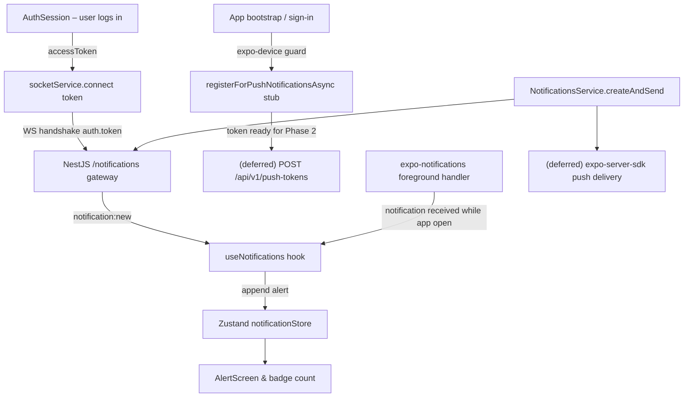

# Real-Time Integration Plan: FanniTech Mobile ↔ Server

## Goal

Connect the FanniTech mobile app to the already-existing NestJS WebSocket gateway (`/notifications` namespace, Socket.IO v4) so that customers receive **live in-app alerts via Socket.IO** whenever their repair-request status changes.

> **Scope decision**: Background push notifications (APNs / FCM via `expo-server-sdk`) are **out of scope for this phase**. They will be added in a follow-up. `expo-notifications` is used only for its **foreground notification handler** (in-app banner/sound) and a stubbed `registerForPushNotificationsAsync` that is ready to be wired up later without rework.

The work is split into two sides:

| Side | What changes |
|---|---|
| **Mobile** | Socket.IO client singleton, expo-notifications foreground handler, expo-device guard stub, Zustand notification store, `useNotifications` hook, AlertScreen wired to live data |
| **Server** | `isUserConnected()` helper on `NotificationsGateway` (minor hardening — no push delivery yet) |

---

## User Review Required

> [!IMPORTANT]
> **All three packages are already installed** in `mobile/package.json` — no installs required:
> - `socket.io-client: ^4.8.4` ✅
> - `expo-notifications: ~57.0.22` ✅
> - `expo-device: ~57.0.2` ✅

> [!IMPORTANT]
> **`app.json` must be updated** to declare `expo-notifications` as an Expo plugin with the notification icon/color. This is needed even for foreground-only usage and requires `expo prebuild` or an EAS build to take effect.

> [!NOTE]
> **Background push (APNs/FCM) is deferred.** The `pushNotificationService.ts` file will contain a ready-to-use `registerForPushNotificationsAsync()` stub, but the server-side `expo-server-sdk` delivery and `UserPushToken` Prisma model are **not part of this phase**. Connecting them later requires only: (1) adding `expo-server-sdk` to the server, (2) running the migration, and (3) calling `savePushTokenToServer()` which already exists in the stub.

---

## Open Questions

> [!IMPORTANT]
> **Notification persistence in the alerts screen**: The existing `AlertScreen` uses fully static mock data inside `useAlerts.ts`. This plan **fully replaces** it with live API (TanStack Query → `GET /api/v1/notifications`) merged with real-time Socket.IO data. The static mock data will be removed. Please confirm this is acceptable or if you'd like to keep the mock as an offline fallback.

---

## Proposed Changes

### Architecture Overview



---

### Mobile – `src/services/`

#### [NEW] `socketService.ts`

A singleton Socket.IO client scoped to the `/notifications` namespace.  
Responsible for: connecting with JWT auth, reconnection, disconnect, and emitting typed events.

```ts
// src/services/socketService.ts
import { io, Socket } from 'socket.io-client';
import { tokenStorage } from '../features/auth/services/tokenStorage';

const BASE_URL = (process.env.EXPO_PUBLIC_API_URL ?? 'http://localhost:8080').replace(/\/$/, '');

type NotificationPayload = {
  id: string;
  type: string;
  title: string;
  body: string;
  data: Record<string, unknown>;
  createdAt: string;
};

type SocketServiceEvents = {
  'notification:new': (payload: NotificationPayload) => void;
};

class SocketService {
  private socket: Socket | null = null;

  async connect(): Promise<void> {
    if (this.socket?.connected) return;
    const token = await tokenStorage.getAccess();
    if (!token) return;

    this.socket = io(`${BASE_URL}/notifications`, {
      transports: ['websocket'],
      auth: { token },
      reconnection: true,
      reconnectionAttempts: 5,
      reconnectionDelay: 2000,
    });
  }

  disconnect(): void {
    this.socket?.disconnect();
    this.socket = null;
  }

  on<K extends keyof SocketServiceEvents>(event: K, listener: SocketServiceEvents[K]): void {
    this.socket?.on(event as string, listener as (...args: unknown[]) => void);
  }

  off<K extends keyof SocketServiceEvents>(event: K, listener: SocketServiceEvents[K]): void {
    this.socket?.off(event as string, listener as (...args: unknown[]) => void);
  }

  emit(event: string, data?: unknown): void {
    this.socket?.emit(event, data);
  }

  isConnected(): boolean {
    return this.socket?.connected ?? false;
  }
}

export const socketService = new SocketService();
```

#### [NEW] `pushNotificationService.ts`

Configures the `expo-notifications` foreground handler (so in-app banners work), requests notification permission, and provides a **stubbed** push token retrieval function guarded by `expo-device`. Token is collected but **not sent to the server yet** — that wiring is part of Phase 2.

```ts
// src/services/pushNotificationService.ts
import * as Notifications from 'expo-notifications';
import * as Device from 'expo-device';
import { Platform } from 'react-native';

// Configure how notifications appear when the app is in the foreground
Notifications.setNotificationHandler({
  handleNotification: async () => ({
    shouldShowAlert: true,
    shouldPlaySound: true,
    shouldSetBadge: true,
    shouldShowBanner: true,
    shouldShowList: true,
  }),
});

/**
 * Requests notification permissions and retrieves the Expo push token.
 * Returns null on simulators (expo-device guard) or when permission is denied.
 *
 * NOTE (Phase 2): wire the returned token to POST /api/v1/push-tokens
 * once the server-side UserPushToken model and endpoint are ready.
 */
export async function registerForPushNotificationsAsync(): Promise<string | null> {
  if (!Device.isDevice) {
    // Simulators cannot receive push notifications
    return null;
  }

  if (Platform.OS === 'android') {
    await Notifications.setNotificationChannelAsync('default', {
      name: 'FanniTech Notifications',
      importance: Notifications.AndroidImportance.MAX,
      vibrationPattern: [0, 250, 250, 250],
      lightColor: '#0051D5',
    });
  }

  const { status: existingStatus } = await Notifications.getPermissionsAsync();
  let finalStatus = existingStatus;

  if (existingStatus !== 'granted') {
    const { status } = await Notifications.requestPermissionsAsync();
    finalStatus = status;
  }

  if (finalStatus !== 'granted') {
    return null;
  }

  const tokenData = await Notifications.getExpoPushTokenAsync();
  return tokenData.data; // Phase 2: send this to server
}
```

---

### Mobile – `src/stores/`

#### [NEW] `notificationStore.ts`

Zustand store for real-time notification state. Lives in `src/stores/` per project architecture (global UI state).

```ts
// src/stores/notificationStore.ts
import { create } from 'zustand';

export interface NotificationItem {
  id: string;
  type: string;
  title: string;
  body: string;
  data: Record<string, unknown>;
  createdAt: string;
  isRead: boolean;
}

interface NotificationStore {
  notifications: NotificationItem[];
  unreadCount: number;
  addNotification: (notification: Omit<NotificationItem, 'isRead'>) => void;
  markAsRead: (id: string) => void;
  markAllAsRead: () => void;
  setNotifications: (notifications: NotificationItem[]) => void;
}

export const useNotificationStore = create<NotificationStore>((set, get) => ({
  notifications: [],
  unreadCount: 0,
  addNotification: (notification) => {
    const item: NotificationItem = { ...notification, isRead: false };
    set((state) => ({
      notifications: [item, ...state.notifications],
      unreadCount: state.unreadCount + 1,
    }));
  },
  markAsRead: (id) => {
    set((state) => {
      const updated = state.notifications.map((n) =>
        n.id === id ? { ...n, isRead: true } : n,
      );
      return { notifications: updated, unreadCount: updated.filter((n) => !n.isRead).length };
    });
  },
  markAllAsRead: () => {
    set((state) => ({
      notifications: state.notifications.map((n) => ({ ...n, isRead: true })),
      unreadCount: 0,
    }));
  },
  setNotifications: (notifications) => {
    set({ notifications, unreadCount: notifications.filter((n) => !n.isRead).length });
  },
}));
```

---

### Mobile – `src/hooks/`

#### [NEW] `useNotifications.ts`

Global hook that subscribes to `socketService` events and feeds the Zustand store. Also sets up foreground Expo notification listeners.

```ts
// src/hooks/useNotifications.ts
import { useEffect } from 'react';
import * as Notifications from 'expo-notifications';
import { socketService } from '../services/socketService';
import { useNotificationStore } from '../stores/notificationStore';

export function useNotifications() {
  const { addNotification, notifications, unreadCount, markAsRead, markAllAsRead } =
    useNotificationStore();

  useEffect(() => {
    // Socket.IO real-time listener
    const handleNew = (payload: {
      id: string; type: string; title: string; body: string;
      data: Record<string, unknown>; createdAt: string;
    }) => {
      addNotification(payload);
    };

    socketService.on('notification:new', handleNew);

    // Foreground Expo notification listener (for background push that arrives while app is open)
    const foregroundSub = Notifications.addNotificationReceivedListener((notification) => {
      const content = notification.request.content;
      addNotification({
        id: notification.request.identifier,
        type: (content.data?.type as string) ?? 'INFO',
        title: content.title ?? '',
        body: content.body ?? '',
        data: (content.data ?? {}) as Record<string, unknown>,
        createdAt: new Date().toISOString(),
      });
    });

    return () => {
      socketService.off('notification:new', handleNew);
      foregroundSub.remove();
    };
  }, [addNotification]);

  return { notifications, unreadCount, markAsRead, markAllAsRead };
}
```

---

### Mobile – `src/features/auth/session/AuthSession.tsx`

#### [MODIFY] `AuthSession.tsx`

Wire socket connect/disconnect and push token registration to the session lifecycle.

```diff
- import React, { createContext, useContext, useEffect, useMemo, useState } from 'react';
+ import React, { createContext, useContext, useEffect, useMemo, useState } from 'react';

  import { AuthServices, AuthSession, AuthUser, LoginInput, RegisterInput } from '../../../services/AuthServices';
  import { getSessionExpiredHandler } from '../../../utils/serverClient';
  import { tokenStorage } from '../services/tokenStorage';
+ import { socketService } from '../../../services/socketService';
+ import { registerForPushNotificationsAsync } from '../../../services/pushNotificationService';

+ async function initRealtime(): Promise<void> {
+   await socketService.connect();
+   // Phase 2: await registerForPushNotificationsAsync() then POST token to server
+   void registerForPushNotificationsAsync(); // requests permission, token discarded until Phase 2
+ }

  // inside AuthSessionProvider useEffect that rehydrates from storage:
  void tokenStorage.getUser<AuthUser>().then((storedUser) => {
    if (!mounted) return;
    setUser(storedUser);
    setStatus(storedUser ? 'authenticated' : 'unauthenticated');
+   if (storedUser) {
+     void initRealtime();
+   }
  });

  // signIn:
- signIn: async (input) => { const session = await AuthServices.login(input); await persistSession(session); setUser(session.user); setStatus('authenticated'); },
+ signIn: async (input) => {
+   const session = await AuthServices.login(input);
+   await persistSession(session);
+   setUser(session.user);
+   setStatus('authenticated');
+   void initRealtime();
+ },

  // signOut:
- signOut: async () => { const refreshToken = await tokenStorage.getRefresh(); await AuthServices.logout(refreshToken); await tokenStorage.clear(); setUser(null); setStatus('unauthenticated'); },
+ signOut: async () => {
+   socketService.disconnect();
+   const refreshToken = await tokenStorage.getRefresh();
+   await AuthServices.logout(refreshToken);
+   await tokenStorage.clear();
+   setUser(null);
+   setStatus('unauthenticated');
+ },
```

---

### Mobile – `src/features/alerts/`

#### [MODIFY] `hooks/useAlerts.ts`

Replace static mock data with live data from:
1. **REST**: `GET /api/v1/notifications` (paginated, via TanStack Query)
2. **Socket.IO**: real-time prepend from `useNotificationStore`

```diff
- import { useState, useMemo, useCallback } from 'react';
+ import { useMemo, useCallback } from 'react';
+ import { useQuery, useMutation, useQueryClient } from '@tanstack/react-query';
  import { AlertItem, AlertCategory } from '../types';
+ import { useNotificationStore } from '../../../stores/notificationStore';
+ import { NotificationsService } from '../services/NotificationsService';
+ import { mapNotificationToAlert } from '../utils/mapNotificationToAlert';

  export function useAlerts() {
-   const [alerts, setAlerts] = useState<AlertItem[]>(INITIAL_ALERTS);
-   const [activeFilter, setActiveFilter] = useState<AlertCategory>('all');
-   const [isRefreshing, setIsRefreshing] = useState(false);

+   const queryClient = useQueryClient();
+   const [activeFilter, setActiveFilter] = useState<AlertCategory>('all');
+   const { notifications, markAsRead: markStoreRead, markAllAsRead: markAllStoreRead } = useNotificationStore();

+   const { data, isRefetching, refetch } = useQuery({
+     queryKey: ['notifications'],
+     queryFn: () => NotificationsService.list({ page: 1, limit: 50 }),
+     staleTime: 30_000,
+   });

+   // Merge server-fetched + real-time Socket.IO notifications
+   const alerts = useMemo<AlertItem[]>(() => {
+     const serverAlerts = (data?.items ?? []).map(mapNotificationToAlert);
+     const realtimeIds = new Set(serverAlerts.map((a) => a.id));
+     const realtimeOnly = notifications
+       .filter((n) => !realtimeIds.has(n.id))
+       .map(mapNotificationToAlert);
+     return [...realtimeOnly, ...serverAlerts];
+   }, [data, notifications]);

-   const markAllAsRead = useCallback(() => { ... }, []);
+   const markAllReadMutation = useMutation({
+     mutationFn: NotificationsService.markAllAsRead,
+     onSuccess: () => { markAllStoreRead(); void queryClient.invalidateQueries({ queryKey: ['notifications'] }); },
+   });

-   const markAsRead = useCallback((alertId: string) => { ... }, []);
+   const markAsReadMutation = useMutation({
+     mutationFn: NotificationsService.markAsRead,
+     onSuccess: (_, id) => { markStoreRead(id); void queryClient.invalidateQueries({ queryKey: ['notifications'] }); },
+   });

    return {
      alerts, filteredAlerts, todayAlerts, earlierAlerts,
      unreadCount, counts, activeFilter, setActiveFilter,
-     isRefreshing, refreshAlerts, markAllAsRead, markAsRead,
+     isRefreshing: isRefetching,
+     refreshAlerts: refetch,
+     markAllAsRead: () => markAllReadMutation.mutate(),
+     markAsRead: (id: string) => markAsReadMutation.mutate(id),
    };
  }
```

#### [NEW] `services/NotificationsService.ts`

Feature-local service for notification REST calls.

```ts
// src/features/alerts/services/NotificationsService.ts
import { serverClient } from '../../../utils/serverClient';

export interface ApiNotification {
  id: string;
  type: string;
  title: string;
  body: string;
  data: Record<string, unknown>;
  createdAt: string;
  readAt: string | null;
}

export interface PaginatedNotifications {
  items: ApiNotification[];
  pagination: { page: number; limit: number; total: number; totalPages: number };
}

export const NotificationsService = {
  list: (query: { page?: number; limit?: number; unreadOnly?: boolean } = {}) =>
    serverClient
      .get<PaginatedNotifications>('/api/v1/notifications', { params: query })
      .then((r) => r.data),

  markAsRead: (id: string) =>
    serverClient.patch(`/api/v1/notifications/${id}/read`).then((r) => r.data),

  markAllAsRead: () =>
    serverClient.patch('/api/v1/notifications/read-all').then((r) => r.data),

  getUnreadCount: () =>
    serverClient
      .get<{ data: { count: number } }>('/api/v1/notifications/unread-count')
      .then((r) => r.data.data.count),
};
```

#### [NEW] `utils/mapNotificationToAlert.ts`

Maps the API/socket notification shape to the existing `AlertItem` UI type.

```ts
// src/features/alerts/utils/mapNotificationToAlert.ts
import { AlertItem } from '../types';
import { ApiNotification } from '../services/NotificationsService';
import { NotificationItem } from '../../../stores/notificationStore';

type NotificationSource = ApiNotification | NotificationItem;

export function mapNotificationToAlert(n: NotificationSource): AlertItem {
  const type = n.type.toLowerCase();
  const createdAt = new Date(n.createdAt);
  const now = new Date();
  const diffMs = now.getTime() - createdAt.getTime();
  const isToday = diffMs < 24 * 60 * 60 * 1000;

  const timeAgo = isToday
    ? diffMs < 3600_000
      ? `${Math.round(diffMs / 60_000)}m ago`
      : `${Math.round(diffMs / 3600_000)}h ago`
    : createdAt.toLocaleDateString('en-US', { month: 'short', day: 'numeric' });

  const isRead = 'isRead' in n ? n.isRead : n.readAt !== null;

  return {
    id: n.id,
    category: type.includes('device') ? 'devices' : 'repairs',
    type: 'status',
    referenceId: (n.data?.referenceId as string) ?? '',
    tag: (n.data?.tag as string) ?? n.type,
    timeAgo,
    title: n.title,
    description: n.body,
    isUnread: !isRead,
    section: isToday ? 'today' : 'earlier',
    technician: (n.data?.technician as string) | undefined,
    location: (n.data?.location as string) | undefined,
  };
}
```

---

### Mobile – `src/app/_layout.tsx`

#### [MODIFY] `_layout.tsx`

Mount the global `useNotifications` hook at root level so the store is populated before any screen renders.

```diff
+ import { useNotifications } from '../hooks/useNotifications';

  function SessionGate() {
    const { status } = useAuthSession();
    const segments = useSegments();
+   useNotifications(); // Subscribe to socket events globally
    ...
  }
```

Also update `HomeScreen.tsx` to get the real unread count:

```diff
// src/app/(app)/HomeScreen.tsx
+ import { useNotificationStore } from '../../stores/notificationStore';

  export default function HomeScreen() {
+   const { unreadCount } = useNotificationStore();
    ...
    <HomeHeader
-     hasUnreadNotifications={true}
+     hasUnreadNotifications={unreadCount > 0}
      ...
    />
  }
```

---

### Mobile – `app.json`

#### [MODIFY] `app.json`

Add `expo-notifications` plugin with required permissions.

```diff
  "plugins": [
    "expo-router",
    "expo-status-bar",
    "expo-secure-store",
+   [
+     "expo-notifications",
+     {
+       "icon": "./assets/icon.png",
+       "color": "#0051D5",
+       "sounds": [],
+       "mode": "production",
+       "androidMode": "default",
+       "iosDisplayInForeground": true
+     }
+   ],
    [
      "expo-image-picker",
      ...
    ]
  ]
```

---

### Server – `src/notifications/`

#### [MODIFY] `notifications.gateway.ts`

Add `isUserConnected()` helper — useful for the service and future push delivery phase.

```diff
+ isUserConnected(userId: string): boolean {
+   const room = this.server.sockets.adapter.rooms.get(`user-${userId}`);
+   return (room?.size ?? 0) > 0;
+ }
```

> [!NOTE]
> `notifications.service.ts` is **not modified** in this phase. Push delivery via `expo-server-sdk` is deferred to Phase 2. The gateway helper is added now so Phase 2 can call it without touching the gateway again.

---

## File Change Summary

### Mobile (`/mobile`)

| File | Action | Purpose |
|---|---|---|
| `src/services/socketService.ts` | **NEW** | Socket.IO singleton for `/notifications` namespace |
| `src/services/pushNotificationService.ts` | **NEW** | Foreground handler + permission stub (Phase 2 ready) |
| `src/stores/notificationStore.ts` | **NEW** | Zustand store for real-time notification state |
| `src/hooks/useNotifications.ts` | **NEW** | Subscribes to socket & foreground expo events |
| `src/features/alerts/services/NotificationsService.ts` | **NEW** | REST calls for notifications feature |
| `src/features/alerts/utils/mapNotificationToAlert.ts` | **NEW** | Adapter: API shape → `AlertItem` |
| `src/features/alerts/hooks/useAlerts.ts` | **MODIFY** | Replace static mock with TanStack Query + real-time store |
| `src/features/auth/session/AuthSession.tsx` | **MODIFY** | Connect socket + call push stub on sign-in/restore |
| `src/app/_layout.tsx` | **MODIFY** | Mount `useNotifications` globally in `SessionGate` |
| `src/app/(app)/HomeScreen.tsx` | **MODIFY** | Use `useNotificationStore().unreadCount` for badge |
| `app.json` | **MODIFY** | Add `expo-notifications` plugin config |

### Server (`/server`) — Phase 1 only

| File | Action | Purpose |
|---|---|---|
| `src/notifications/notifications.gateway.ts` | **MODIFY** | Add `isUserConnected()` helper |

> [!NOTE]
> **Deferred to Phase 2** (background push): `expo-server-sdk`, `UserPushToken` Prisma model, `push-tokens` module, `POST /api/v1/push-tokens` endpoint, `notifications.service.ts` push delivery.

---

## Verification Plan

### Automated Tests

```bash
# Mobile – typecheck
cd mobile && npx tsc --noEmit

# Mobile – unit tests
cd mobile && npm run test

# Server – typecheck + lint
cd server && npx tsc --noEmit
cd server && npm run lint

# Server – unit tests
cd server && npm run test
```

### Manual Verification

1. **Socket connection**: Log in → confirm server logs `Client connected: userId=...`
2. **Real-time notification**: Trigger `NotificationsService.createAndSend` from server → confirm alert appears live in `AlertScreen` without refresh
3. **Badge count**: Unread notification → `HomeScreen` bell icon shows badge
4. **Push permission stub**: First launch on physical device → OS permission prompt appears (token collected but not sent to server yet)
5. **expo-device guard**: Run in Expo Go simulator → no permission prompt, no crash, socket still works
6. **Mark as read**: Tap alert → REST `PATCH /:id/read` fires, `isUnread` flips
7. **Mark all as read**: Tap "Mark all" → `PATCH /read-all` fires, store clears unread count
8. **Disconnect on logout**: Sign out → server logs `Client disconnected`
9. **Socket reconnect**: Kill and restart app while authenticated → socket reconnects automatically
10. **AlertScreen live data**: Pull-to-refresh fetches from `GET /api/v1/notifications` — no more static mock data
