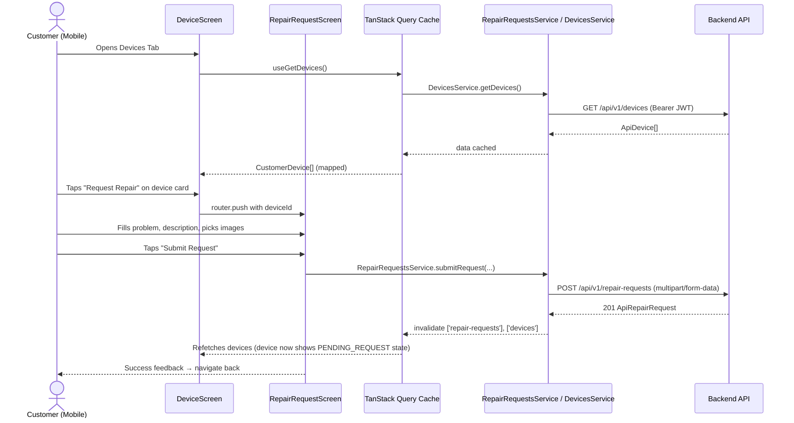

# Mobile API Integration: Device & Repair Request Endpoints

## Goal Description

Integrate the backend REST API endpoints defined in `docs/tasks/customer-submit-repair-request.md` into the FanniTech mobile application (`/mobile`). The backend exposes:

- `POST /api/v1/devices` — Register a new device
- `GET /api/v1/devices` — List customer's devices
- `POST /api/v1/repair-requests` — Submit a repair request (`multipart/form-data` + optional images)
- `GET /api/v1/repair-requests` — List customer's repair requests (paginated)
- `GET /api/v1/repair-requests/:id` — Get repair request details (with Cloudinary image URLs)
- `PATCH /api/v1/repair-requests/:id/cancel` — Cancel a pending repair request

Currently, the `DeviceScreen` uses **hardcoded mock data** (`INITIAL_DEVICES` in `useDevices.ts`) and all device interactions (register, remove, request repair) are stubbed with `Alert.alert(...)`. The `repair-requests` feature module does not yet exist.

This plan replaces the mock data with real TanStack Query + Axios service calls, creates the full `repair-requests` feature module following the established project architecture, and wires up the navigation for the repair request submission flow.

---

## User Review Required

> [!IMPORTANT]
> **Image Picker Dependency**: The backend accepts up to 5 images via `multipart/form-data`. `expo-image-picker` is already in `package.json`. The plan uses it for image selection. No new native dependencies need to be added.

> [!NOTE]
> **`react-hook-form`** (`^7.89.0`) is already installed. The repair request submission form will use `react-hook-form` for form state, validation, and submission handling.

> [!NOTE]
> **Type alignment**: The existing `CustomerDevice` UI type has a `DeviceCategory` union (`'Laptop' | 'Desktop'`) and several mock-only fields that do not match the API shape. All types will be **replaced** to exactly mirror the API response — `deviceType` becomes a plain `string`, mock-only display fields (`addedDate`, `locationLabel`, `serviceRecordLabel`) are removed, and `repairState` is derived at query time from the request list rather than a hardcoded field.

> [!NOTE]
> **`useDevices` hook refactor**: The existing `useDevices.ts` hook manages local UI state (selected device, menu device). The plan keeps this pattern but delegates data fetching to TanStack Query hooks (`useGetDevices`, `useRegisterDevice`, `useDeleteDevice`), keeping the separation clean per `AGENTS.md` guidelines.

---

## Open Questions

> [!IMPORTANT]
> **Register Device UI**: Should clicking "Register Device" open a bottom sheet/modal within `DeviceScreen`, or navigate to a separate dedicated screen? The plan defaults to a **modal bottom sheet** consistent with existing `DeviceDetailsSheet` patterns.

> [!NOTE]
> **Repair request submission flow**: The plan adds a new `RepairRequestScreen` route reachable from `DeviceCard → "Request Repair"` button. Should this be a modal (stack presented over tabs) or a full-page tab screen?

---

## Proposed Changes

Changes are ordered by dependency layer: types → services → hooks → screens/navigation.

---

### 1. Shared API Types

#### [NEW] `src/types/api.ts`
Centralizes shared API response types used by both devices and repair-requests features.

```ts
export interface ApiError {
  error: { code: string; message: string; details?: unknown };
}

export interface PaginatedResponse<T> {
  data: T[];
  meta: { total: number; page: number; limit: number; totalPages: number };
}
```

---

### 2. Device Feature — Types & Service

#### [MODIFY] `src/features/devices/types/index.ts`
Replace all mock-only types with API-aligned types that **exactly mirror** the backend response shape. Components consume the API types directly — no mapping layer is introduced.

```diff
-export type DeviceCategory = 'Laptop' | 'Desktop';
-export type DeviceRepairState = 'ACTIVE_REPAIR' | 'NO_REPAIRS' | 'PENDING_REQUEST';
-export interface CustomerDevice { ... }   // mock shape with mock-only fields

+// Exact mirror of the backend API response
+export interface ApiDevice {
+  id: string;
+  customerId: string;
+  deviceType: string;      // free-form: "Laptop", "Smartphone", etc.
+  brand: string;
+  model: string;
+  serialNumber: string | null;
+  createdAt: string;
+  updatedAt: string;
+}

+export interface RegisterDeviceInput {
+  deviceType: string;
+  brand: string;
+  model: string;
+  serialNumber?: string;
+}

+// repairState is derived at query time by joining with the repair-requests
+// response — DeviceCard and DeviceDetailsSheet receive ApiDevice directly
+// plus an optional computed repairState passed as a prop.
+export type DeviceRepairState = 'ACTIVE_REPAIR' | 'NO_REPAIRS' | 'PENDING_REQUEST';
```

> [!IMPORTANT]
> **No mapping functions.** Components that previously consumed `CustomerDevice` will be updated to accept `ApiDevice` directly. Display-only derived fields (e.g. `name = brand + model`) are computed **inline inside the component JSX**, not in a utility or service function. `repairState` is computed in the TanStack Query `select` callback as a minimal inline transform (not a named mapper).

#### [NEW] `src/features/devices/services/DevicesService.ts`
Handles all device API communication.

```ts
import { serverClient } from '../../../utils/serverClient';
import { ApiDevice, RegisterDeviceInput } from '../types';

export const DevicesService = {
  getDevices: () =>
    serverClient.get<ApiDevice[]>('/api/v1/devices').then(r => r.data),

  registerDevice: (input: RegisterDeviceInput) =>
    serverClient.post<ApiDevice>('/api/v1/devices', input).then(r => r.data),

  // Placeholder until DELETE endpoint is confirmed by backend:
  // deleteDevice: (deviceId: string) =>
  //   serverClient.delete(`/api/v1/devices/${deviceId}`),
};
```

#### [MODIFY] `src/features/devices/hooks/useDevices.ts`
Replace mock data with TanStack Query. Keep local UI state (selected/menu device) in a separate `useDevicesUiState` hook. No mapping functions — `ApiDevice[]` flows directly from the query.

```ts
import { useQuery, useMutation, useQueryClient } from '@tanstack/react-query';
import { DevicesService } from '../services/DevicesService';
import { ApiDevice } from '../types';

export const DEVICES_QUERY_KEY = ['devices'] as const;

export function useGetDevices() {
  return useQuery<ApiDevice[]>({
    queryKey: DEVICES_QUERY_KEY,
    queryFn: DevicesService.getDevices,
    // No select/transform — components receive ApiDevice directly
  });
}

export function useRegisterDevice() {
  const queryClient = useQueryClient();
  return useMutation({
    mutationFn: DevicesService.registerDevice,
    onSuccess: () => queryClient.invalidateQueries({ queryKey: DEVICES_QUERY_KEY }),
  });
}

// Manages sheet/menu open state only — no server data
export function useDevicesUiState() { ... }
```

#### [MODIFY] `src/features/devices/index.ts`
Export new hooks and service.

---

### 3. Repair Requests Feature Module

The entire `repair-requests` feature is **new**.

```
src/features/repair-requests/
├── types/
│   └── index.ts
├── services/
│   └── RepairRequestsService.ts
├── hooks/
│   ├── useRepairRequests.ts
│   └── useSubmitRepairRequest.ts
├── components/
│   ├── RepairRequestCard.tsx
│   ├── RepairRequestsEmptyState.tsx
│   ├── RepairRequestsErrorState.tsx
│   ├── ImagePickerGrid.tsx
│   └── index.ts
├── __tests__/
│   └── RepairRequestsService.test.ts
└── index.ts
```

#### [NEW] `src/features/repair-requests/types/index.ts`

```ts
export type RepairRequestStatus = 'PENDING' | 'ACCEPTED' | 'REJECTED' | 'CANCELLED';

export interface RepairRequestImage {
  id: string;
  url: string;
  publicId: string;
  fileName: string;
  mimeType: string;
  size: number;
}

export interface ApiRepairRequest {
  id: string;
  deviceId: string;
  problem: string;
  description: string;
  status: RepairRequestStatus;
  images: RepairRequestImage[];
  createdAt: string;
  updatedAt: string;
}

export interface SubmitRepairRequestInput {
  deviceId: string;
  problem: string;
  description: string;
  images?: {
    uri: string;
    name: string;
    type: string;
  }[];
}

export interface RepairRequestsQuery {
  page?: number;
  limit?: number;
  status?: RepairRequestStatus;
}
```

#### [NEW] `src/features/repair-requests/services/RepairRequestsService.ts`
Uses `multipart/form-data` for image uploads. The `serverClient` already attaches the Bearer token.

```ts
import { serverClient } from '../../../utils/serverClient';
import { ApiRepairRequest, SubmitRepairRequestInput, RepairRequestsQuery } from '../types';
import { PaginatedResponse } from '../../../types/api';

export const RepairRequestsService = {
  submitRequest: async (input: SubmitRepairRequestInput): Promise<ApiRepairRequest> => {
    const form = new FormData();
    form.append('deviceId', input.deviceId);
    form.append('problem', input.problem);
    form.append('description', input.description);
    input.images?.forEach(img =>
      form.append('images', { uri: img.uri, name: img.name, type: img.type } as any)
    );
    const { data } = await serverClient.post<ApiRepairRequest>('/api/v1/repair-requests', form, {
      headers: { 'Content-Type': 'multipart/form-data' },
    });
    return data;
  },

  listRequests: (query: RepairRequestsQuery = {}) =>
    serverClient
      .get<PaginatedResponse<ApiRepairRequest>>('/api/v1/repair-requests', { params: query })
      .then(r => r.data),

  getRequestById: (requestId: string) =>
    serverClient
      .get<ApiRepairRequest>(`/api/v1/repair-requests/${requestId}`)
      .then(r => r.data),

  cancelRequest: (requestId: string) =>
    serverClient
      .patch<ApiRepairRequest>(`/api/v1/repair-requests/${requestId}/cancel`)
      .then(r => r.data),
};
```

#### [NEW] `src/features/repair-requests/hooks/useRepairRequests.ts`

```ts
import { useQuery, useMutation, useQueryClient } from '@tanstack/react-query';
import { RepairRequestsService } from '../services/RepairRequestsService';
import { RepairRequestsQuery } from '../types';

export const REPAIR_REQUESTS_QUERY_KEY = ['repair-requests'] as const;

export function useGetRepairRequests(query: RepairRequestsQuery = {}) {
  return useQuery({
    queryKey: [...REPAIR_REQUESTS_QUERY_KEY, query],
    queryFn: () => RepairRequestsService.listRequests(query),
  });
}

export function useGetRepairRequestById(requestId: string) {
  return useQuery({
    queryKey: [...REPAIR_REQUESTS_QUERY_KEY, requestId],
    queryFn: () => RepairRequestsService.getRequestById(requestId),
    enabled: !!requestId,
  });
}

export function useCancelRepairRequest() {
  const queryClient = useQueryClient();
  return useMutation({
    mutationFn: RepairRequestsService.cancelRequest,
    onSuccess: () => {
      queryClient.invalidateQueries({ queryKey: REPAIR_REQUESTS_QUERY_KEY });
      queryClient.invalidateQueries({ queryKey: ['devices'] }); // refresh repair state on device cards
    },
  });
}
```

#### [NEW] `src/features/repair-requests/hooks/useSubmitRepairRequest.ts`
Manages the submission form state via **`react-hook-form`** and the image picker via `expo-image-picker`.

```ts
import { useForm } from 'react-hook-form';
import * as ImagePicker from 'expo-image-picker';
import { useMutation, useQueryClient } from '@tanstack/react-query';
import { RepairRequestsService } from '../services/RepairRequestsService';
import { REPAIR_REQUESTS_QUERY_KEY } from './useRepairRequests';
import { DEVICES_QUERY_KEY } from '../../devices/hooks/useDevices';

const MAX_IMAGES = 5;

interface RepairRequestFormValues {
  problem: string;
  description: string;
}

export function useSubmitRepairRequest(deviceId: string) {
  const queryClient = useQueryClient();

  // react-hook-form owns problem + description state & validation
  const form = useForm<RepairRequestFormValues>({
    defaultValues: { problem: '', description: '' },
  });

  // expo-image-picker state lives separately (not a form field)
  const [pickedImages, setPickedImages] = useState<ImagePicker.ImagePickerAsset[]>([]);

  const pickImages = async () => {
    const { status } = await ImagePicker.requestMediaLibraryPermissionsAsync();
    if (status !== 'granted') return; // handled gracefully in UI
    const result = await ImagePicker.launchImageLibraryAsync({
      mediaTypes: ImagePicker.MediaTypeOptions.Images,
      allowsMultipleSelection: true,
      quality: 0.8,
      selectionLimit: MAX_IMAGES - pickedImages.length,
    });
    if (!result.canceled) {
      setPickedImages(prev => [...prev, ...result.assets].slice(0, MAX_IMAGES));
    }
  };

  const removeImage = (uri: string) =>
    setPickedImages(prev => prev.filter(img => img.uri !== uri));

  const mutation = useMutation({
    mutationFn: (values: RepairRequestFormValues) =>
      RepairRequestsService.submitRequest({
        deviceId,
        problem: values.problem,
        description: values.description,
        images: pickedImages.map(img => ({
          uri: img.uri,
          name: img.fileName ?? `image-${Date.now()}.jpg`,
          type: img.mimeType ?? 'image/jpeg',
        })),
      }),
    onSuccess: () => {
      queryClient.invalidateQueries({ queryKey: REPAIR_REQUESTS_QUERY_KEY });
      queryClient.invalidateQueries({ queryKey: DEVICES_QUERY_KEY });
    },
  });

  return {
    form,                          // react-hook-form instance
    pickedImages, pickImages, removeImage,
    submit: form.handleSubmit((values) => mutation.mutate(values)),
    isSubmitting: mutation.isPending,
    isSuccess: mutation.isSuccess,
    error: mutation.error,
  };
}
```

#### [NEW] `src/features/repair-requests/components/RepairRequestCard.tsx`
Displays a single repair request summary row (used in the requests list).

#### [NEW] `src/features/repair-requests/components/ImagePickerGrid.tsx`
Renders the selected images thumbnail grid with add/remove controls.

---

### 4. New Screens & Navigation

#### [NEW] `src/app/(app)/RepairRequestScreen.tsx`
A new screen reachable when the user taps **"Request Repair"** on a `DeviceCard` with `repairState === 'NO_REPAIRS'`.

```
Navigation path:
  DeviceScreen → DeviceCard "Request Repair" → RepairRequestScreen (stack push)
```

This screen will contain:
1. A header with the device name.
2. A `TextInput` for `problem` (summary, max 150 chars).
3. A `TextInput` (multiline) for `description` (detailed notes, max 2000 chars).
4. An `ImagePickerGrid` component (up to 5 images, optional).
5. A "Submit Request" `TouchableOpacity` button.
6. Success and error states.

The screen uses `useSubmitRepairRequest(deviceId)`.

#### [NEW] `src/app/(app)/RepairRequestsListScreen.tsx`
A screen listing all repair requests for the authenticated customer (paginated). Accessible from the HomeScreen or a future "Requests" tab.

#### [MODIFY] `src/app/(app)/_layout.tsx`
Register the two new screens so Expo Router can navigate to them. These are stack-style screens presented over the tab bar (using `Tabs.Screen` with `href: null` or a nested Stack layout within `(app)`).

```diff
+<Tabs.Screen name="RepairRequestScreen" options={{ href: null, headerShown: false }} />
+<Tabs.Screen name="RepairRequestsListScreen" options={{ href: null, headerShown: false }} />
```

#### [MODIFY] `src/app/(app)/DeviceScreen.tsx`
Replace the stubbed `handlePrimaryAction` and `handleRegisterDevice` handlers with real navigation + real API mutations.

```diff
-const handlePrimaryAction = (device: CustomerDevice) => {
-  Alert.alert('Request Repair', `...`);
-}

+const handlePrimaryAction = (device: CustomerDevice) => {
+  if (device.repairState === 'NO_REPAIRS') {
+    router.push({ pathname: '/(app)/RepairRequestScreen', params: { deviceId: device.id, deviceName: device.name } });
+    return;
+  }
+  // PENDING_REQUEST / ACTIVE_REPAIR → navigate to requests list / ticket detail
+};
```

Replace `useDevices()` with `useGetDevices()` for server data and keep `useDevicesUiState()` for local sheet/menu state.

---

### 5. TanStack Query Provider (Verify)

TanStack Query's `QueryClientProvider` must wrap the app. Verify it exists in `src/app/_layout.tsx`.

#### [MODIFY] `src/app/_layout.tsx` *(if not already present)*

```ts
import { QueryClient, QueryClientProvider } from '@tanstack/react-query';
const queryClient = new QueryClient();

// wrap children with <QueryClientProvider client={queryClient}>
```

---

### 6. Tests

#### [NEW] `src/features/repair-requests/__tests__/RepairRequestsService.test.ts`
Unit tests mocking `serverClient`:
- `submitRequest` happy path with and without images.
- `submitRequest` with 403 (device not owned) — checks error propagation.
- `listRequests` with status filter.
- `cancelRequest` from `PENDING` status.

#### [MODIFY] `src/features/devices/__tests__/DeviceComponents.test.tsx`
Update tests to use mocked TanStack Query responses instead of `INITIAL_DEVICES`.

---

## Data Flow Diagram



---

## Verification Plan

### Automated Tests

```bash
cd mobile
npm run test                # Jest unit tests
npm run typecheck           # TypeScript type checking (tsc --noEmit)
```

Key test scenarios:
- `RepairRequestsService.submitRequest` sends `multipart/form-data` with correct fields.
- `useGetDevices` maps `ApiDevice[]` to `CustomerDevice[]` correctly.
- Cancel mutation invalidates both `repair-requests` and `devices` query keys.

### Manual Verification

1. Start the dev server: `npx expo start`
2. Log in as a customer (use existing auth flow).
3. **Devices Tab**: Verify real devices are loaded from `GET /api/v1/devices` (not mock data).
4. **Register Device**: Tap "Register Device" → fill form → confirm device appears in list.
5. **Submit Repair Request**:
   - Select a device with `NO_REPAIRS` state.
   - Tap "Request Repair" → fill problem + description → optionally attach images.
   - Submit → verify 201 response, device card updates to `PENDING_REQUEST`.
6. **Cancel Request**:
   - Navigate to repair requests list → find `PENDING` request → cancel it.
   - Verify device card reverts to `NO_REPAIRS`.
7. **Error States**: Disconnect network → verify error states and retry options are shown.
8. **Loading States**: Verify `ActivityIndicator` appears while requests are in-flight.
