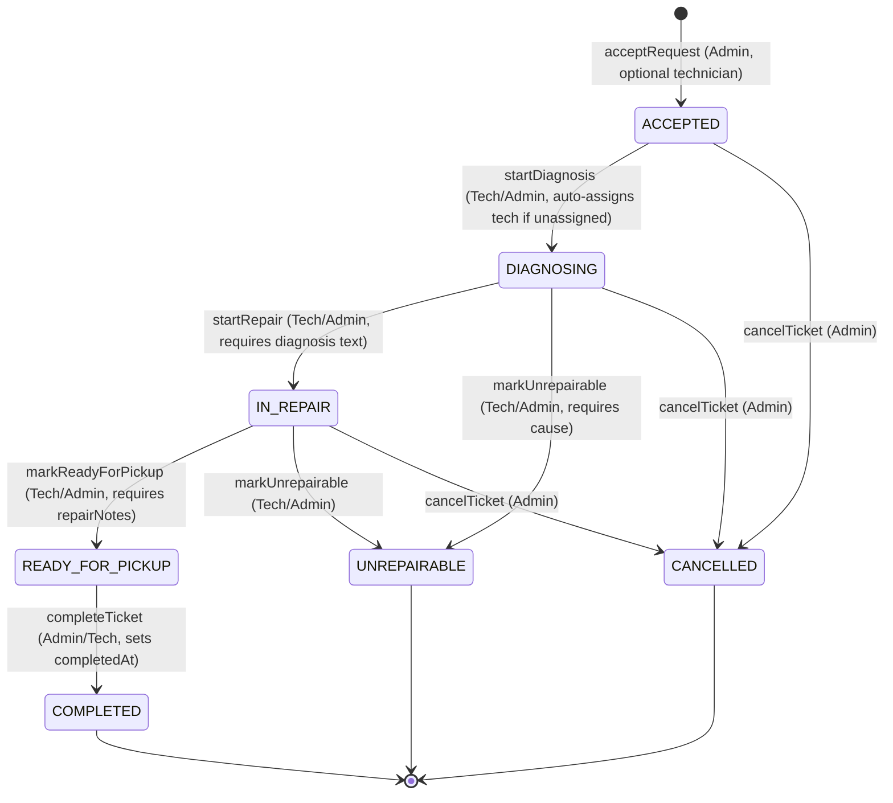

# Repair Request Management Feature (Admin & Technician) — Implementation Plan

## Goal Description

The `repair-request-managment` module is the **Repair Center Management** counterpart to the existing customer-facing `repair-requests` module. According to [project-plan.md](file:///Users/amrassal/Documents/Projects/FanniTech/docs/project-plan.md), it serves two primary internal center actors: **Admin** and **Technician**:

1. **Admin Operations**:
   - **Request Triage**: View incoming `PENDING` repair requests with customer and device details, accept them (generating a `RepairTicket` with optional technician assignment and priority), or reject them with a mandatory reason.
   - **Ticket Oversight**: View all tickets across the center, assign or reassign technicians, adjust priority, override ticket status, or cancel tickets.
   - **Completion**: Mark tickets as `COMPLETED` when the customer picks up the repaired device.

2. **Technician Operations**:
   - **Technician Queue**: View assigned tickets queue (filtered to the authenticated technician or center-wide), inspect device specifications and customer problem description.
   - **Diagnosis & Repair Workflow**: 
     - Transition `ACCEPTED → DIAGNOSING` (auto-assigning the technician if unassigned).
     - Transition `DIAGNOSING → IN_REPAIR` with mandatory `diagnosis` notes.
     - Transition `IN_REPAIR → READY_FOR_PICKUP` with mandatory `repairNotes`.
     - Transition active tickets to `UNREPAIRABLE` with reason notes.
     - Mark repairs as `COMPLETED`.
   - **Audit Trail**: View ticket status history and notes.

3. **Schema Extension**:
   - Add `RepairTicket` and `RepairStatusHistory` Prisma models.
   - Add `RepairTicketStatus` and `RepairTicketPriority` enums.
   - Implement dynamic ticket number sequence generation (`TK-YYYY-0001`) matching the `next_admin_employee_id()` pattern.

The module currently exists as an empty scaffold in `server/src/repair-request-managment/`. This plan establishes the end-to-end implementation.

---

## User Decisions & Architectural Alignment

> [!NOTE]
> **Dynamic Ticket Number Generation (Approved)**:
> Ticket numbers use the dynamic current year `TO_CHAR(NOW(), 'YYYY')` and a PostgreSQL sequence, mirroring the existing `next_admin_employee_id()` pattern:
> - Sequence: `repair_ticket_seq START 1`
> - Function: `next_repair_ticket_number() RETURNS TEXT`
> - Format: `TK-YYYY-0001` (e.g., `TK-2026-0001`)
> - In Prisma: `@default(dbgenerated("next_repair_ticket_number()"))`

> [!NOTE]
> **Technician Integration with Admin (Approved per `project-plan.md`)**:
> - **Accept Request**: Admin can assign a technician immediately upon accepting a request (`technicianId` in accept payload), or leave it unassigned.
> - **Auto-assignment**: If a ticket is unassigned and a technician begins diagnosis (`ACCEPTED → DIAGNOSING`), the system auto-assigns that ticket to the technician.
> - **Dedicated Assignment Endpoint**: Admin can also assign or reassign technicians at any time via `PATCH /tickets/:id/assign-technician`.
> - **Technician Queue**: Technicians can filter tickets to view their personal queue (`assignedToMe=true` or filter by `technicianId`).

---

## Actor Matrix & Role Permissions (from `project-plan.md` §4 & §7.3)

| Operation | Endpoint | Permitted Roles | Description | Side Effects & Notifications |
|---|---|---|---|---|
| **List Requests** | `GET /requests` | `ADMIN` | List incoming requests (paginated, filterable by status) | None |
| **Get Request** | `GET /requests/:id` | `ADMIN`, `TECHNICIAN` | View single request with device, customer, images | None |
| **Accept Request** | `PATCH /requests/:id/accept` | `ADMIN` | Accept request & create `RepairTicket` (sets priority, optional `technicianId`) | Creates ticket & initial history; notifies customer (`REPAIR_REQUEST_ACCEPTED` + `TECHNICIAN_ASSIGNED` if assigned) |
| **Reject Request** | `PATCH /requests/:id/reject` | `ADMIN` | Reject request with mandatory reason | Updates request to `REJECTED`; notifies customer (`REPAIR_REQUEST_REJECTED`) |
| **List Tickets** | `GET /tickets` | `ADMIN`, `TECHNICIAN` | List tickets (filter by status, priority, technician, or `assignedToMe`) | None |
| **Get Ticket** | `GET /tickets/:id` | `ADMIN`, `TECHNICIAN` | Full ticket details, device, customer, technician, history | None |
| **Get History** | `GET /tickets/:id/history` | `ADMIN`, `TECHNICIAN` | Status audit trail for ticket | None |
| **Assign Technician** | `PATCH /tickets/:id/assign-technician` | `ADMIN` | Assign or reassign technician to ticket | Updates `technicianId`; notifies customer (`TECHNICIAN_ASSIGNED`) |
| **Start Diagnosis** | `PATCH /tickets/:id/diagnose` | `ADMIN`, `TECHNICIAN` | `ACCEPTED → DIAGNOSING` | Auto-assigns technician if unassigned; logs history |
| **Start Repair** | `PATCH /tickets/:id/repair` | `ADMIN`, `TECHNICIAN` | `DIAGNOSING → IN_REPAIR` | Saves `diagnosis` text; logs history; notifies customer (`REPAIR_STATUS_UPDATED`) |
| **Ready for Pickup** | `PATCH /tickets/:id/ready-for-pickup` | `ADMIN`, `TECHNICIAN` | `IN_REPAIR → READY_FOR_PICKUP` | Saves `repairNotes` text; logs history; notifies customer (`REPAIR_READY_FOR_PICKUP`) |
| **Complete Ticket** | `PATCH /tickets/:id/complete` | `ADMIN`, `TECHNICIAN` | `READY_FOR_PICKUP → COMPLETED` | Sets `completedAt`; logs history; notifies customer (`REPAIR_COMPLETED`) |
| **Mark Unrepairable** | `PATCH /tickets/:id/unrepairable` | `ADMIN`, `TECHNICIAN` | Any active state → `UNREPAIRABLE` | Saves cause in `repairNotes`; logs history; notifies customer (`REPAIR_STATUS_UPDATED`) |
| **Cancel Ticket** | `PATCH /tickets/:id/cancel` | `ADMIN` | Any active state → `CANCELLED` | Sets completion timestamp; logs history |

---

## State Transition Matrix (Enforced by Domain Guards)



---

## Proposed Changes

### Component 1: Database Schema & Migration

#### [MODIFY] [server/prisma/schema.prisma](file:///Users/amrassal/Documents/Projects/FanniTech/server/prisma/schema.prisma)

1. Add `RepairTicketStatus` and `RepairTicketPriority` enums:
```prisma
enum RepairTicketStatus {
  ACCEPTED
  DIAGNOSING
  IN_REPAIR
  READY_FOR_PICKUP
  COMPLETED
  UNREPAIRABLE
  CANCELLED
}

enum RepairTicketPriority {
  LOW
  MEDIUM
  HIGH
}
```

2. Add `RepairTicket` relation to `Technician` and `RepairRequest`:
```prisma
model Technician {
  id         String   @id @default(uuid())
  user       User     @relation(fields: [id], references: [id], onDelete: Cascade)
  employeeId String   @unique @default(dbgenerated("next_technician_employee_id()"))
  createdAt  DateTime @default(now())
  updatedAt  DateTime @updatedAt
  repairTickets RepairTicket[]

  @@index([id])
}

model RepairRequest {
  // ... existing fields ...
  repairTicket RepairTicket?
}
```

3. Add `RepairTicket` and `RepairStatusHistory` models:
```prisma
model RepairTicket {
  id            String               @id @default(uuid())
  requestId     String               @unique
  request       RepairRequest        @relation(fields: [requestId], references: [id], onDelete: Cascade)
  technicianId  String?
  technician    Technician?          @relation(fields: [technicianId], references: [id], onDelete: SetNull)
  ticketNumber  String               @unique @default(dbgenerated("next_repair_ticket_number()"))
  priority      RepairTicketPriority @default(MEDIUM)
  status        RepairTicketStatus   @default(ACCEPTED)
  diagnosis     String?
  repairNotes   String?
  statusHistory RepairStatusHistory[]
  createdAt     DateTime             @default(now())
  updatedAt     DateTime             @updatedAt
  completedAt   DateTime?

  @@index([technicianId])
  @@index([status])
  @@index([requestId])
}

model RepairStatusHistory {
  id        String             @id @default(uuid())
  ticketId  String
  ticket    RepairTicket       @relation(fields: [ticketId], references: [id], onDelete: Cascade)
  status    RepairTicketStatus
  notes     String?
  changedAt DateTime           @default(now())

  @@index([ticketId])
}
```

4. Database Migration:
Create migration containing sequence and dynamic year generator function:
```sql
CREATE SEQUENCE repair_ticket_seq START 1;

CREATE OR REPLACE FUNCTION next_repair_ticket_number() RETURNS TEXT AS $$
    SELECT 'TK-' || TO_CHAR(NOW(), 'YYYY') || '-' || LPAD(NEXTVAL('repair_ticket_seq')::TEXT, 4, '0');
$$ LANGUAGE SQL;
```

---

### Component 2: DTOs (`src/repair-request-managment/dto/`)

All DTOs validate incoming requests with Zod schemas matching `ZodValidationPipe`:

1. **`accept-repair-request.dto.ts`**:
   - `priority`: `RepairTicketPriority` (optional, default `'MEDIUM'`)
   - `technicianId`: `z.string().uuid().optional()` (optional technician assignment on accept)

2. **`reject-repair-request.dto.ts`**:
   - `reason`: `z.string().trim().min(5).max(500)`

3. **`assign-technician.dto.ts`**:
   - `technicianId`: `z.string().uuid()`

4. **`start-diagnosis.dto.ts`**:
   - `notes`: `z.string().trim().max(2000).optional()`

5. **`start-repair.dto.ts`**:
   - `diagnosis`: `z.string().trim().min(5).max(2000)` (mandatory technical diagnosis)
   - `notes`: `z.string().trim().max(2000).optional()`

6. **`mark-ready-for-pickup.dto.ts`**:
   - `repairNotes`: `z.string().trim().min(5).max(2000)` (mandatory repair notes)
   - `notes`: `z.string().trim().max(2000).optional()`

7. **`mark-unrepairable.dto.ts`**:
   - `reason`: `z.string().trim().min(5).max(2000)` (explanation why device is unrepairable)
   - `notes`: `z.string().trim().max(2000).optional()`

8. **`update-ticket-status.dto.ts`**:
   - `notes`: `z.string().trim().max(2000).optional()`

9. **`list-repair-requests-query.dto.ts`**:
   - `page`: `z.coerce.number().int().positive().default(1)`
   - `limit`: `z.coerce.number().int().min(1).max(50).default(10)`
   - `status`: `z.nativeEnum(RepairRequestStatus).optional()`

10. **`list-tickets-query.dto.ts`**:
    - `page`: `z.coerce.number().int().positive().default(1)`
    - `limit`: `z.coerce.number().int().min(1).max(50).default(10)`
    - `status`: `z.nativeEnum(RepairTicketStatus).optional()`
    - `priority`: `z.nativeEnum(RepairTicketPriority).optional()`
    - `technicianId`: `z.string().uuid().optional()`
    - `assignedToMe`: `z.coerce.boolean().optional()` (convenience filter for technicians)

---

### Component 3: Service (`repair-request-managment.service.ts`)

Implements all business logic, state machines, and notifications:

- **`listRequests(query)`**: Admin view of incoming requests, paginated, filtered by status, ordered by `createdAt: desc`, including device and customer info.
- **`getRequestById(id)`**: Full request view with images, device specs, and customer info.
- **`acceptRequest(id, dto)`**:
  - Validates request exists and is in `PENDING` status.
  - If `dto.technicianId` is provided, verifies that technician exists in DB.
  - In a Prisma transaction:
    - Updates `RepairRequest.status = ACCEPTED`
    - Creates `RepairTicket` with priority, `technicianId`, and default status `ACCEPTED` (generates `ticketNumber` via db sequence)
    - Creates initial `RepairStatusHistory` record (`status: ACCEPTED`)
  - Triggers `notificationsService.createAndSend` (`REPAIR_REQUEST_ACCEPTED` to customer).
  - If technician assigned, also sends `TECHNICIAN_ASSIGNED` to customer.
- **`rejectRequest(id, dto)`**:
  - Validates request is `PENDING`.
  - Updates `status = REJECTED`.
  - Notifies customer (`REPAIR_REQUEST_REJECTED`) with rejection reason.
- **`listTickets(query, user)`**:
  - Paginated list of tickets with total count.
  - If `user.role === 'TECHNICIAN'` and `query.assignedToMe === true` (or defaulted), filters `technicianId = user.sub`.
  - Filters by `status`, `priority`, `technicianId`.
  - Includes device, customer, technician info, and latest status.
- **`getTicketById(ticketId)`**:
  - Returns complete ticket: device, customer, technician profile, and status history.
- **`assignTechnician(ticketId, dto)`**:
  - Verifies technician exists.
  - Updates ticket `technicianId`.
  - Dispatches `TECHNICIAN_ASSIGNED` notification to customer.
- **`startDiagnosis(ticketId, user, dto)`**:
  - Validates current status is `ACCEPTED`.
  - If ticket has no `technicianId` and caller is a `TECHNICIAN`, auto-assigns `technicianId = user.sub`.
  - In transaction: updates status to `DIAGNOSING` and logs history.
- **`startRepair(ticketId, dto)`**:
  - Validates current status is `DIAGNOSING`.
  - In transaction: updates status to `IN_REPAIR`, saves `diagnosis = dto.diagnosis`, logs history.
  - Dispatches `REPAIR_STATUS_UPDATED` notification to customer.
- **`markReadyForPickup(ticketId, dto)`**:
  - Validates current status is `IN_REPAIR`.
  - In transaction: updates status to `READY_FOR_PICKUP`, saves `repairNotes = dto.repairNotes`, logs history.
  - Dispatches `REPAIR_READY_FOR_PICKUP` notification to customer.
- **`completeTicket(ticketId, dto)`**:
  - Validates current status is `READY_FOR_PICKUP`.
  - In transaction: updates status to `COMPLETED`, sets `completedAt = new Date()`, logs history.
  - Dispatches `REPAIR_COMPLETED` notification to customer.
- **`markUnrepairable(ticketId, dto)`**:
  - Validates ticket is in an active non-terminal state (`ACCEPTED`, `DIAGNOSING`, `IN_REPAIR`).
  - In transaction: updates status to `UNREPAIRABLE`, saves `repairNotes = dto.reason`, logs history.
  - Dispatches `REPAIR_STATUS_UPDATED` notification to customer.
- **`cancelTicket(ticketId, dto)`**:
  - Validates ticket is in an active non-terminal state.
  - In transaction: updates status to `CANCELLED`, sets `completedAt = new Date()`, logs history.
- **`getTicketHistory(ticketId)`**:
  - Returns chronologically sorted `RepairStatusHistory` records.

---

### Component 4: Controller (`repair-request-managment.controller.ts`)

- Route base: `api/v1/repair-request-management`
- Swagger Tag: `@ApiTags('Repair Request Management')`
- `@ApiBearerAuth()` and `@UseGuards(AuthenticationGuard, RolesGuard)`
- Endpoints structure:
  - `GET /requests` — `@Roles('ADMIN')`
  - `GET /requests/:id` — `@Roles('ADMIN', 'TECHNICIAN')`
  - `PATCH /requests/:id/accept` — `@Roles('ADMIN')`
  - `PATCH /requests/:id/reject` — `@Roles('ADMIN')`
  - `GET /tickets` — `@Roles('ADMIN', 'TECHNICIAN')`
  - `GET /tickets/:id` — `@Roles('ADMIN', 'TECHNICIAN')`
  - `GET /tickets/:id/history` — `@Roles('ADMIN', 'TECHNICIAN')`
  - `PATCH /tickets/:id/assign-technician` — `@Roles('ADMIN')`
  - `PATCH /tickets/:id/diagnose` — `@Roles('ADMIN', 'TECHNICIAN')`
  - `PATCH /tickets/:id/repair` — `@Roles('ADMIN', 'TECHNICIAN')`
  - `PATCH /tickets/:id/ready-for-pickup` — `@Roles('ADMIN', 'TECHNICIAN')`
  - `PATCH /tickets/:id/complete` — `@Roles('ADMIN', 'TECHNICIAN')`
  - `PATCH /tickets/:id/unrepairable` — `@Roles('ADMIN', 'TECHNICIAN')`
  - `PATCH /tickets/:id/cancel` — `@Roles('ADMIN')`

---

### Component 5: Module Wiring (`repair-request-managment.module.ts`)

Imports:
- `PrismaModule`
- `AuthenticationModule`
- `NotificationsModule`

---

### Component 6: Swagger Schemas (`swagger.schemas.ts`)

Adds typed Swagger models:
- `RepairTicketResponse` (with customer, device, technician, and timestamps)
- `RepairStatusHistoryResponse`
- `RepairRequestAdminResponse`
- `AcceptRepairRequestBody`, `RejectRepairRequestBody`, `AssignTechnicianBody`
- `StartRepairBody`, `MarkReadyForPickupBody`, `MarkUnrepairableBody`, `UpdateTicketStatusBody`

---

### Component 7: Tests

1. **`repair-request-managment.service.spec.ts`**:
   - `listRequests`: pagination and filtering.
   - `acceptRequest`:
     - Creates ticket + history atomically.
     - Handles `technicianId` assignment at accept time.
     - Validates technician exists when provided (throws 404 if not found).
     - Throws 409 Conflict if request is not `PENDING`.
     - Dispatches `REPAIR_REQUEST_ACCEPTED` and `TECHNICIAN_ASSIGNED` notifications.
   - `rejectRequest`:
     - Transitions status to `REJECTED`, dispatches notification.
     - Throws 409 if not `PENDING`.
   - `listTickets`:
     - Center-wide listing for Admin.
     - Queue filtering for Technician (`assignedToMe`).
   - `startDiagnosis`:
     - Transitions `ACCEPTED → DIAGNOSING`.
     - Auto-assigns technician if unassigned and caller is Technician.
     - Throws 409 if invalid state.
   - `startRepair`:
     - Transitions `DIAGNOSING → IN_REPAIR`, persists `diagnosis`, dispatches notification.
   - `markReadyForPickup`:
     - Transitions `IN_REPAIR → READY_FOR_PICKUP`, persists `repairNotes`, dispatches notification.
   - `completeTicket`:
     - Transitions `READY_FOR_PICKUP → COMPLETED`, sets `completedAt`, dispatches notification.
   - `markUnrepairable`:
     - Transitions active ticket to `UNREPAIRABLE`, persists reason, dispatches notification.
   - `cancelTicket`:
     - Admin-only cancellation, sets terminal state.
   - `getTicketHistory`:
     - Returns audit trail ordered by `changedAt`.

2. **`repair-request-managment.controller.spec.ts`**:
   - Verifies controller instantiates with dependencies.
   - Verifies route handler delegation to service methods.

---

## Verification Plan

### Automated Verification
```bash
# Run unit tests for repair request management
npm run test -- --testPathPattern=repair-request-managment

# Run all project unit tests
npm run test

# Type-check TypeScript compilation
npm run build
```

### Manual API & Workflow Verification
1. Apply Prisma migration: `npx prisma migrate dev --name add_repair_ticket_management`
2. Run `npx prisma generate` to refresh types.
3. Start dev server: `npm run start:dev`
4. Test Admin triage: submit request via Customer endpoint, accept as Admin with technician assigned -> verify ticket created with `TK-2026-0001` format.
5. Test Technician lifecycle: as Technician, call `diagnose` -> `repair` with diagnosis notes -> `ready-for-pickup` with repair notes -> `complete`.
6. Verify status history audit records are logged at each step.
7. Verify WebSocket / push notifications delivered to customer.
