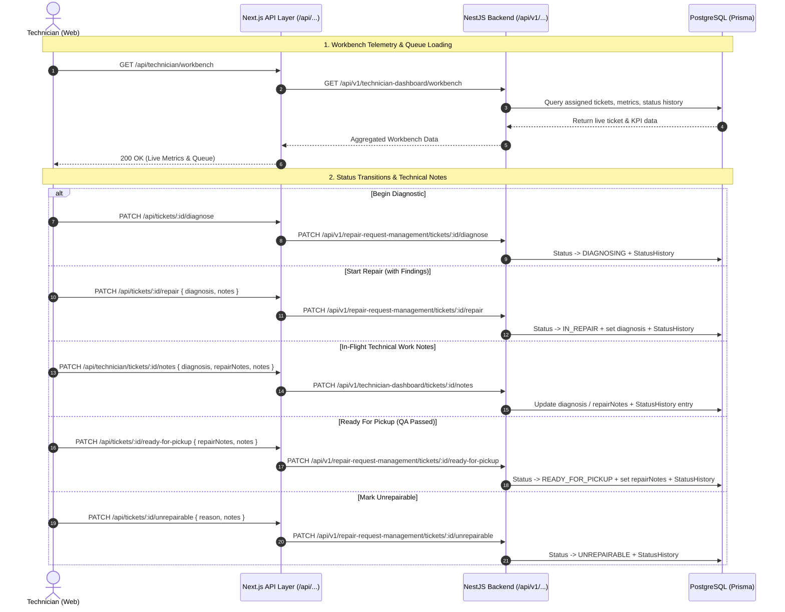

# Technician Role & API Endpoints Implementation Plan

> **Note on Data Model**: Per confirmation, `employedDate` is mapped directly to `Technician.createdAt` in this version. No database schema migration or alter table is required.

---

## 1. Goal Description

Implement the complete **Technician Role** and **Workbench Dashboard** across the entire stack according to [`docs/project-plan.md`](../project-plan.md) (Use Cases `UT1` through `UT6`, Domain Class `Technician`, and Lifecycle Section 3.2):
- Implement real backend endpoints in `server/src/technician-dashboard` for workbench KPIs, assigned ticket queues, active mat focus, and in-flight technical notes.
- Notify the assigned technician in real time when an admin/dispatch assigns a ticket to them.
- Wrap all technician endpoints in the Next.js API layer (`web/src/app/api/...`) with automatic JWT session refresh.
- Wire all interactive actions on the web workbench (Quick Notes, Begin Diagnostic, Start Repair with findings, Mark Ready for QA with repair notes, Mark Unrepairable with reason, and Ticket Details/Images drawer) to real backend APIs.

---

## 2. API Architecture & Endpoint Specification



---

## 3. Endpoints Matrix: Backend vs Next.js Wrappers

| Feature / Action | Backend NestJS Endpoint | HTTP | Allowed Role | Next.js API Wrapper Route | Client Service Method |
| :--- | :--- | :--- | :--- | :--- | :--- |
| **Workbench Telemetry & Metrics** | `/api/v1/technician-dashboard/workbench` | `GET` | `TECHNICIAN` | `/api/technician/workbench` | `fetchTechnicianWorkbench()` |
| **List Assigned Tickets** | `/api/v1/repair-request-management/tickets?assignedToMe=true` | `GET` | `TECHNICIAN` | `/api/tickets?assignedToMe=true` | `fetchRepairTickets({ assignedToMe: true })` |
| **Get Ticket Details & Photos** | `/api/v1/repair-request-management/tickets/:id` | `GET` | `TECHNICIAN` | `/api/tickets/:id` | `fetchRepairTicketById(id)` |
| **Get Ticket Status Audit Log** | `/api/v1/repair-request-management/tickets/:id/history` | `GET` | `TECHNICIAN` | `/api/tickets/:id/history` | `fetchTicketHistory(id)` |
| **Save In-Flight Technical Notes** | `/api/v1/technician-dashboard/tickets/:id/notes` | `PATCH` | `TECHNICIAN` | `/api/technician/tickets/[id]/notes` | `updateTechnicianTicketNotes(id, dto)` |
| **Start Diagnosis** (`ACCEPTED` $\to$ `DIAGNOSING`) | `/api/v1/repair-request-management/tickets/:id/diagnose` | `PATCH` | `TECHNICIAN` | `/api/tickets/[id]/diagnose` | `startTicketDiagnosis(id, notes)` |
| **Start Repair** (`DIAGNOSING` $\to$ `IN_REPAIR`) | `/api/v1/repair-request-management/tickets/:id/repair` | `PATCH` | `TECHNICIAN` | `/api/tickets/[id]/repair` | `startTicketRepair(id, diagnosis, notes)` |
| **Ready for Pickup** (`IN_REPAIR` $\to$ `READY_FOR_PICKUP`) | `/api/v1/repair-request-management/tickets/:id/ready-for-pickup` | `PATCH` | `TECHNICIAN` | `/api/tickets/[id]/ready-for-pickup` | `markTicketReadyForPickup(id, repairNotes, notes)` |
| **Mark Unrepairable** (Any Active $\to$ `UNREPAIRABLE`) | `/api/v1/repair-request-management/tickets/:id/unrepairable` | `PATCH` | `TECHNICIAN` | `/api/tickets/[id]/unrepairable` | `markTicketUnrepairable(id, reason, notes)` |
| **Complete Ticket** (`READY_FOR_PICKUP` $\to$ `COMPLETED`) | `/api/v1/repair-request-management/tickets/:id/complete` | `PATCH` | `TECHNICIAN` | `/api/tickets/[id]/complete` | `completeTicket(id, notes)` |

---

## 4. Detailed Specification of Proposed Endpoints

### 4.1 Backend: `GET /api/v1/technician-dashboard/workbench`
- **Controller**: `TechnicianDashboardController`
- **Auth**: `AuthenticationGuard`, `@Roles('TECHNICIAN')`
- **Behavior**:
  - Resolves `req.user.sub` to the technician record.
  - Queries assigned tickets with status `ACCEPTED`, `DIAGNOSING`, `IN_REPAIR`, `READY_FOR_PICKUP`.
  - Computes counts: `activeQueueCount`, `criticalUrgentCount` (`priority === HIGH`), `underDiagnosisCount`, `inRepairCount`, `readyForQACount`, `completedTodayCount`.
  - Determines `activeMatTicket`: Highest-priority ticket in `DIAGNOSING` or `IN_REPAIR` (or most recently updated).
  - Queries recent `RepairStatusHistory` on the technician's tickets for the activity feed.
  - Returns technician profile info (`name`, `email`, `employeeId`, `employedDate: technician.createdAt`).

### 4.2 Backend: `PATCH /api/v1/technician-dashboard/tickets/:id/notes`
- **Controller**: `TechnicianDashboardController`
- **Auth**: `AuthenticationGuard`, `@Roles('TECHNICIAN')`
- **Validation Schema (Zod)**:
  ```ts
  export const UpdateTechnicianNotesDtoSchema = z.object({
    diagnosis: z.string().trim().max(2000).optional(),
    repairNotes: z.string().trim().max(2000).optional(),
    notes: z.string().trim().max(1000).optional(),
  });
  ```
- **Behavior**:
  - Validates that the ticket exists and is assigned to the calling technician.
  - Updates `diagnosis` and/or `repairNotes` on `RepairTicket`.
  - If `notes` is provided, creates an audit record in `RepairStatusHistory` with the ticket's current status and the note.

### 4.3 Backend: Assignment Notification Fix
- In `RepairRequestManagmentService.notifyTechnicianAssigned`:
  - In addition to customer notification, dispatch an in-app notification to `ticket.technicianId` (the technician's user ID):
    - `type: NotificationType.TECHNICIAN_ASSIGNED`
    - `title: 'New Ticket Assigned'`
    - `body: 'Ticket ${ticket.ticketNumber} has been assigned to your bench.'`

---

## 5. Proposed File Changes

### Component 1: Server Backend (`server/src/technician-dashboard/`)
#### [NEW] `server/src/technician-dashboard/dto/technician-dashboard.dto.ts`
- Zod schemas for workbench queries and updating technical notes.
#### [NEW] `server/src/technician-dashboard/technician-dashboard.service.ts`
- Service aggregating workbench metrics, assigned tickets, activity stream, and updating in-flight notes.
#### [NEW] `server/src/technician-dashboard/technician-dashboard.controller.ts`
- REST controller exposing `GET workbench` and `PATCH tickets/:id/notes`.
#### [MODIFY] `server/src/technician-dashboard/technician-dashboard.module.ts`
- Provide controller and service, import `PrismaModule` and `NotificationsModule`.
#### [MODIFY] `server/src/repair-request-managment/repair-request-managment.service.ts`
- Dispatch assignment notification to the technician's user ID.

---

### Component 2: Next.js API Routes (`web/src/app/api/`)
#### [NEW] `web/src/app/api/technician/workbench/route.ts`
- Route handler calling `/api/v1/technician-dashboard/workbench` with session cookie auth and automatic token refresh.
#### [NEW] `web/src/app/api/technician/tickets/[id]/notes/route.ts`
- Route handler forwarding note updates to `/api/v1/technician-dashboard/tickets/:id/notes`.

---

### Component 3: Frontend Services & Hooks (`web/src/services/` & `web/src/Hooks/`)
#### [MODIFY] `web/src/services/technicianDashboard.service.ts`
- Replace initial static mock return with real API calls to `/api/technician/workbench`.
- Add `updateTechnicianTicketNotes(ticketId, data)`.
#### [MODIFY] `web/src/Hooks/useTechnicianDashboard.ts`
- Support SWR revalidation and mutation helpers for workbench actions.

---

### Component 4: Web UI Workbench (`web/src/components/TechnicianDashboard/`)
#### [NEW] `web/src/components/TechnicianDashboard/TicketTransitionModal.tsx`
- Modal dialog for state transitions requiring input:
  - Diagnosis findings (required for `IN_REPAIR`).
  - Repair notes (required for `READY_FOR_PICKUP`).
  - Unrepairable explanation (required for `UNREPAIRABLE`).
#### [NEW] `web/src/components/TechnicianDashboard/TicketDetailDrawer.tsx`
- Slide-over drawer displaying:
  - Device specs & full customer problem description.
  - Customer damage photo gallery (`RepairRequestImage`).
  - Status history timeline (`RepairStatusHistory`).
#### [MODIFY] `web/src/components/TechnicianDashboard/AssignedQueueSection.tsx`
- Connect "Quick Notes" to `updateTechnicianTicketNotes`.
- Connect action buttons ("Begin Diagnostic", "Resume", "Log Completion to QA") to `TicketTransitionModal` and `startTicketDiagnosis`.
- Add "Work on Bench" button to set any ticket onto the top active mat card.
- Add "View Details" to open `TicketDetailDrawer`.
#### [MODIFY] `web/src/components/TechnicianDashboard/ActiveBenchCard.tsx`
- Bind live to the active ticket, updating stages and calling transitions directly.

---

## 6. Verification Plan

### Automated Tests
1. **Server Tests**:
   ```bash
   cd server && npm test src/technician-dashboard
   ```
2. **Web Build & Typecheck**:
   ```bash
   cd web && npm run build
   ```

### Manual Verification
1. Log in as a technician $\to$ verify live metrics and assigned ticket list reflect database state.
2. Click "Save Notes" on a ticket $\to$ reload page $\to$ verify notes persist.
3. Advance a ticket from `ACCEPTED` to `DIAGNOSING` $\to$ verify status update in DB.
4. Advance from `DIAGNOSING` to `IN_REPAIR` with diagnosis text $\to$ verify ticket update and customer notification.
5. Advance to `READY_FOR_PICKUP` $\to$ verify customer notification.
6. Open Ticket Detail Drawer $\to$ verify customer photos and history log display properly.

