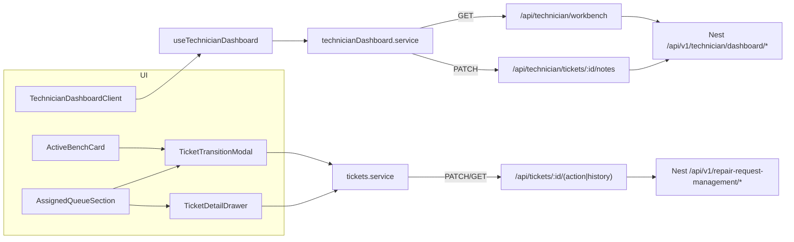

# Technician Workbench — Web Client Integration (Combined Plan)

This plan merges two sources:
1. The earlier **workbench integration plan**: wire `GET /api/v1/technician/dashboard/workbench`, remove every piece of dummy data, and reshape the UI to the exact API payload.
2. The **Web Client section** (Components 2–4) of [technician-role-plan.md](file:///Users/amrassal/Documents/Projects/FanniTech/docs/tasks/technician-role-plan.md#L130-L167): Next.js routes, service and hook, Quick Notes, status transitions (`TicketTransitionModal`), `TicketDetailDrawer`, "Work on Bench", and a live `ActiveBenchCard`.

The backend (Component 1 of the doc) is **already implemented** and is out of scope.

## Background

### Backend endpoints the web client will use (all exist)

| Action | Backend | Next.js route | Client fn | Status |
|---|---|---|---|---|
| Workbench | `GET /api/v1/technician/dashboard/workbench` | `/api/technician/workbench` | `fetchTechnicianWorkbench()` | route is a **stub** → implement |
| Save notes | `PATCH /api/v1/technician/dashboard/tickets/:id/notes` | `/api/technician/tickets/[id]/notes` | `updateTechnicianTicketNotes()` | **new** route + fn |
| Ticket details | `GET …/repair-request-management/tickets/:id` | `/api/tickets/[id]` ✅ | `fetchRepairTicketById()` ✅ | reuse |
| History | `GET …/tickets/:id/history` | `/api/tickets/[id]/history` ✅ | `fetchTicketHistory()` ✅ | reuse |
| Diagnose `ACCEPTED→DIAGNOSING` | `PATCH …/tickets/:id/diagnose` | `/api/tickets/[id]/diagnose` ✅ | `startTicketDiagnosis()` ✅ | reuse |
| Repair `DIAGNOSING→IN_REPAIR` | `PATCH …/tickets/:id/repair` (diagnosis ≥ 5 chars) | ✅ | `startTicketRepair()` ✅ | reuse |
| Ready `IN_REPAIR→READY_FOR_PICKUP` | `PATCH …/tickets/:id/ready-for-pickup` (repairNotes ≥ 5) | ✅ | `markTicketReadyForPickup()` ✅ | reuse |
| Complete `READY_FOR_PICKUP→COMPLETED` | `PATCH …/tickets/:id/complete` | ✅ | `completeTicket()` ✅ | reuse |
| Unrepairable (any active) | `PATCH …/tickets/:id/unrepairable` (reason ≥ 5) | ✅ | `markTicketUnrepairable()` ✅ | reuse |

All transition proxies already go through [`[action]/route.ts`](file:///Users/amrassal/Documents/Projects/FanniTech/web/src/app/api/tickets/[id]/[action]/route.ts) with token refresh, and through [tickets.service.ts](file:///Users/amrassal/Documents/Projects/FanniTech/web/src/services/tickets.service.ts).

### Workbench payload (no global interceptor, so it arrives as raw JSON)

```ts
{
  technician: { id, employeeId, name, email, phone, createdAt, updatedAt },
  metrics: { activeQueueCount, criticalUrgentCount, underDiagnosisCount,
             inRepairCount, readyForQACount, completedTodayCount },
  activeTicket: RepairTicket | null,     // includes request.device.customer.user, images, technician.user, statusHistory
  assignedTickets: RepairTicket[],       // ACCEPTED | DIAGNOSING | IN_REPAIR | READY_FOR_PICKUP
  recentActivities: { id, ticketId, status, notes, changedAt, ticket: { id, ticketNumber } }[]
}
```

### Decisions you already made
- Remove every UI section that has no API data behind it.
- Remove Bench Scratchpad and Fast Device Check-In.
- Wire Quick Notes to the PATCH notes endpoint.



## User Review Required

> [!WARNING]
> **Deleted files** (no data behind them, removed from the dashboard): `BenchRigTelemetry.tsx`, `BenchScratchpad.tsx`, `FastDeviceCheckIn.tsx`, `SchematicModal.tsx`.

> [!IMPORTANT]
> **Doc discrepancies.** The role plan lists backend paths as `/api/v1/technician-dashboard/...`, but the real controller uses `/api/v1/technician/dashboard/...`. The doc also mentions `employedDate` and `activeMatTicket`, while the API returns `createdAt` and `activeTicket`. This plan follows the **real API**. As the last step I'll also correct those lines in the doc and tick off the web-client items.

> [!NOTE]
> The drawer (`TicketDetailDrawer`) will be built using shadcn UI Drawer / Sheet pattern styled for clean consistency. Success and error feedback will show as inline banners.

## Open Questions

> [!IMPORTANT]
> 1. **"Work on Bench" behavior.** Proposed: it's client-side only. It sets `selectedTicketId` in the zustand store, and the Active Bench Card shows that ticket instead of the server-chosen `activeTicket`. There's no backend field for "on bench", so the choice resets on reload. Is that OK?
> 2. **Complete action.** The backend allows a technician to mark `READY_FOR_PICKUP → COMPLETED`, and the doc lists it in its matrix but not in its UI section. Proposed: add a "Mark Picked Up / Complete" button on READY tickets. Should I include it?

---

## Proposed Changes

### 1. Types

#### [MODIFY] [technicianDashboard.ts](file:///Users/amrassal/Documents/Projects/FanniTech/web/src/types/technicianDashboard.ts)
Replace all mock interfaces (`TelemetryRail`, `ThermalHotspot`, `ActiveMatTicket`, `RigDevice`, `BenchActivityItem`, the old `TechnicianDashboardData`) with exact API types:

```ts
import type { RepairTicket, RepairTicketStatus } from "@/types/tickets";

export interface WorkbenchTechnician {
  id: string; employeeId: string; name: string; email: string;
  phone: string | null; createdAt: string; updatedAt: string;
}
export interface WorkbenchMetrics {
  activeQueueCount: number; criticalUrgentCount: number; underDiagnosisCount: number;
  inRepairCount: number; readyForQACount: number; completedTodayCount: number;
}
export interface WorkbenchActivity {
  id: string; ticketId: string; status: RepairTicketStatus;
  notes: string | null; changedAt: string;
  ticket: { id: string; ticketNumber: string };
}
export interface TechnicianWorkbenchData {
  technician: WorkbenchTechnician;
  metrics: WorkbenchMetrics;
  activeTicket: RepairTicket | null;
  assignedTickets: RepairTicket[];
  recentActivities: WorkbenchActivity[];
}
export interface UpdateTechnicianNotesPayload {
  diagnosis?: string; repairNotes?: string; notes?: string;
}
export type TicketTransitionAction =
  | "diagnose" | "repair" | "ready-for-pickup" | "complete" | "unrepairable";
```

---

### 2. Next.js API routes (doc Component 2)

#### [MODIFY] [workbench/route.ts](file:///Users/amrassal/Documents/Projects/FanniTech/web/src/app/api/technician/workbench/route.ts)
Finish the stub using the same pattern as [tickets/route.ts](file:///Users/amrassal/Documents/Projects/FanniTech/web/src/app/api/tickets/route.ts):
- Fix the missing `await` on `cookies()`.
- If there's no access token, refresh with the refresh token. On a 401 from the backend, retry once.
- Write rotated tokens back to cookies.
- Errors return `{ success:false, message }` with the upstream status code.

```ts
export async function GET() {
  const cookieStore = await cookies();
  // ...token / refresh handling identical to tickets route...
  const fetchWorkbench = (token: string, rt?: string) =>
    serverClient.get<TechnicianWorkbenchData>(
      "/api/v1/technician/dashboard/workbench",
      { headers: getAuthHeaders(token, rt ?? refreshToken) },
    );
  // ...401 retry...
  const response = NextResponse.json({ success: true, data: result.data });
  // set refreshed cookies when needed
  return response;
}
```

#### [NEW] `web/src/app/api/technician/tickets/[id]/notes/route.ts`
A `PATCH` handler that forwards to `PATCH /api/v1/technician/dashboard/tickets/:id/notes`:
- Signature: `context: { params: Promise<{ id: string }> }`, matching Next 16 as used in `[action]/route.ts`.
- Strips the body down to `diagnosis`, `repairNotes` and `notes`.
- Uses the same refresh and retry logic.
- Returns `{ success: true, data: ticket }`.

---

### 3. Services, hook, store (doc Component 3)

#### [MODIFY] [technicianDashboard.service.ts](file:///Users/amrassal/Documents/Projects/FanniTech/web/src/services/technicianDashboard.service.ts)
Delete `initialTechnicianDashboardData` (~290 lines of mock data) and the `/api/tickets` fallback that hid errors.

```ts
export const TECHNICIAN_WORKBENCH_KEY = "/api/technician/workbench";

export const fetchTechnicianWorkbench = async (): Promise<TechnicianWorkbenchData> => {
  const res = await appClient.get<{ success: boolean; data: TechnicianWorkbenchData }>(TECHNICIAN_WORKBENCH_KEY);
  return res.data.data;
};

export const updateTechnicianTicketNotes = async (
  ticketId: string, payload: UpdateTechnicianNotesPayload,
): Promise<RepairTicket> => {
  const res = await appClient.patch<{ success: boolean; data: RepairTicket }>(
    `/api/technician/tickets/${ticketId}/notes`, payload);
  return res.data.data;
};

/** Dispatches a status transition through the existing tickets.service helpers. */
export const runTicketTransition = (
  ticketId: string, action: TicketTransitionAction,
  input: { text?: string; notes?: string },
) => { /* switch → startTicketDiagnosis / startTicketRepair / markTicketReadyForPickup / completeTicket / markTicketUnrepairable */ };
```

#### [MODIFY] [useTechnicianDashboard.ts](file:///Users/amrassal/Documents/Projects/FanniTech/web/src/Hooks/useTechnicianDashboard.ts)
- Remove `fallbackData` and keep the 15 s refresh.
- Return `{ data, isLoading, isError, error, mutate, saveNotes, transition }`.
- `saveNotes` and `transition` call the service and then `await mutate()`, so metrics, the queue and the activity feed all refresh together.

#### [MODIFY] [technicianDashboardUIStore.ts](file:///Users/amrassal/Documents/Projects/FanniTech/web/src/Portal/technicianDashboardUIStore.ts)
- **Remove:** `benchHold`, `activeStep`, `isTimerRunning`, `timerSeconds`, `schematicModalOpen`, `scratchpadText`, and their setters.
- **Keep:** `searchQuery`, `statusFilter`, `selectedTicketId` (now the "Work on Bench" ticket), `resetFilters`.
- **Add:** `detailTicketId: string | null` (drawer) and `transition: { ticketId; action } | null` (modal), with setters.

---

### 4. UI components (doc Component 4 + dummy-data removal)

#### [MODIFY] [TechnicianDashboardClient.tsx](file:///Users/amrassal/Documents/Projects/FanniTech/web/src/components/TechnicianDashboard/TechnicianDashboardClient.tsx)
- Replace the error copy (drop the fake IP `192.168.1.14`) with "Unable to load workbench" and a Retry button.
- Bench ticket = `assignedTickets.find(id === selectedTicketId) ?? activeTicket`. If neither exists, show an empty "No ticket on the bench" card.
- Pass the first DIAGNOSING / IN_REPAIR / READY ticket into the metric-card subtitles. This replaces the hardcoded `"TCK-2038"`.
- Layout: queue on the left (8 cols), `BenchActivityStream` on the right (4 cols).
- Mount `TicketTransitionModal` and `TicketDetailDrawer` once at the root. Both are driven by the store.
- Remove `FastDeviceCheckIn`, `BenchRigTelemetry`, `BenchScratchpad` and `SchematicModal`.

#### [MODIFY] [WorkbenchHeader.tsx](file:///Users/amrassal/Documents/Projects/FanniTech/web/src/components/TechnicianDashboard/WorkbenchHeader.tsx)
- Props are now `technician`, `activeCount` and `readyCount`, with no fake defaults.
- Remove the BAY / CAL-ID / Shift / bench-hold row. Show `employeeId`, email, and "Since {createdAt}".
- Pluralize the pill labels correctly.

#### [MODIFY] [OperationalMetricsStrip.tsx](file:///Users/amrassal/Documents/Projects/FanniTech/web/src/components/TechnicianDashboard/OperationalMetricsStrip.tsx)
- Five real cards: **Active Queue** (+ critical count, with a proportional bar), **Under Diagnosis**, **In Repair** (new), **Ready for Pickup**, **Completed Today**.
- Remove pass rate, ahead-of-target, average diagnostic time and SLA.

#### [MODIFY] [ActiveBenchCard.tsx](file:///Users/amrassal/Documents/Projects/FanniTech/web/src/components/TechnicianDashboard/ActiveBenchCard.tsx)
Prop: `ticket: RepairTicket`. This makes the card live, as the doc asks.
- **Header:** priority and status badges, `ticketNumber · brand model (deviceType)`, and a live "Time in current stage" counted from the last `statusHistory.changedAt`.
- **Client column:** computed initials, name, phone, email and customer notes. Intake defect comes from `request.problem` / `description`. Also shows S/N and the opened date.
- **Findings column** (replaces the fake rails/thermal): Diagnosis and Repair Notes, shown as "Not recorded yet" when empty, plus thumbnails of the request images.
- **Stepper:** `ACCEPTED → DIAGNOSING → IN_REPAIR → READY_FOR_PICKUP`. Done/current state comes from `status`, and each step's timestamp from `statusHistory`.
- **Primary action button**, based on status: Begin Diagnostic / Start Repair / Mark Ready for Pickup / Complete (Q2). It opens the `TicketTransitionModal`.
- **Secondary buttons:** "Mark Unrepairable" (opens the modal) and "View Details" (opens the drawer).
- **Removed:** fake Pause, Set In-Repair, Advance step, and the schematic link.

#### [MODIFY] [AssignedQueueSection.tsx](file:///Users/amrassal/Documents/Projects/FanniTech/web/src/components/TechnicianDashboard/AssignedQueueSection.tsx)
- Replace the hardcoded `TCK-2042` / `TCK-2038` spec boxes with Device Type, Serial No. and Photos count.
- Replace the hardcoded footer hints with the latest `statusHistory` note.
- **Quick Notes:** controlled fields for diagnosis, repair notes and an optional log note. Save calls `saveNotes`, with saving and error states, and the editor closes on success.
- **Actions** per status:
  - `ACCEPTED`: "Begin Diagnostic"
  - `DIAGNOSING`: "Start Repair"
  - `IN_REPAIR`: "Log Completion to QA"
  - `READY_FOR_PICKUP`: "Complete" (Q2)
  - Every action opens `TicketTransitionModal`.
- **New buttons:** "Work on Bench" (sets `selectedTicketId`, scrolls to top, and is highlighted when active) and "View Details" (opens the drawer).
- **Tabs:** remove `COMPLETED` from the Ready filter, since the API never returns it. Rename the tab to "Ready for Pickup".

#### [MODIFY] [getTurnaroundTarget.tsx](file:///Users/amrassal/Documents/Projects/FanniTech/web/src/components/TechnicianDashboard/_components/getTurnaroundTarget.tsx)
- Replace the fake countdown strings with "Updated {relative time}". High priority keeps its red styling.
- Rename the label to "Last update".

#### [MODIFY] [BenchActivityStream.tsx](file:///Users/amrassal/Documents/Projects/FanniTech/web/src/components/TechnicianDashboard/BenchActivityStream.tsx)
- Prop: `activities: WorkbenchActivity[]`. Remove the default mock list.
- Each row shows `HH:mm`, a dot colored by status, "{status label}" plus the ticket number, and the notes as detail. Clicking the ticket number opens the drawer.
- Shows an empty state when there's no activity.

#### [NEW] `web/src/components/TechnicianDashboard/TicketTransitionModal.tsx`
Driven by `store.transition`. The config per action:

| action | title | required field | min length |
|---|---|---|---|
| `diagnose` | Begin Diagnostic | — (optional note) | — |
| `repair` | Start Repair | Diagnosis findings (prefilled from `ticket.diagnosis`) | 5 |
| `ready-for-pickup` | Mark Ready for Pickup | Repair notes (prefilled from `ticket.repairNotes`) | 5 |
| `complete` | Complete Ticket | — (optional note) | — |
| `unrepairable` | Mark Unrepairable | Reason | 5 |

- Validates input on the client with the same rules as the proxy route.
- Calls `transition()` from the hook and shows the backend `message` if it fails.
- Closes and revalidates on success. If the ticket on the bench leaves the active statuses, `selectedTicketId` is cleared.

#### [NEW] `web/src/components/TechnicianDashboard/TicketDetailDrawer.tsx`
A right-side slide-over drawer built using shadcn UI Drawer / Sheet pattern, driven by `store.detailTicketId`.
- Loads data with `useSWR(['/api/tickets', id], fetchRepairTicketById)` and `useSWR(['/api/tickets', id, 'history'], fetchTicketHistory)`.
- **Sections:** device specs (type, brand, model, S/N), customer contact, problem and description, diagnosis and repair notes, a photo gallery (`request.images[].url`, opens full size in a new tab), and a status-history timeline.
- Has loading and error states.

#### [NEW] `web/src/components/TechnicianDashboard/_components/formatters.ts`
Shared helpers: `formatRelativeTime`, `formatClock`, `formatDuration`, `getInitials`, `statusLabel`, `nextActionFor(status)`.

#### [DELETE] BenchRigTelemetry.tsx · BenchScratchpad.tsx · FastDeviceCheckIn.tsx · SchematicModal.tsx

---

### 5. Docs

#### [MODIFY] [technician-role-plan.md](file:///Users/amrassal/Documents/Projects/FanniTech/docs/tasks/technician-role-plan.md)
- Correct the backend paths to `/api/v1/technician/dashboard/...`, `employedDate` to `createdAt`, and `activeMatTicket` to `activeTicket`.
- Mark Components 2–4 as implemented and list the removed components.

---

## Verification Plan

### Automated Tests
```bash
cd web && npx tsc --noEmit
cd web && npm run lint
cd web && npm run build
grep -rnE "Ahmed|TCK-20|Bay #04|192\.168|PQ301" web/src   # expect no matches
```

### Manual Verification
1. Log in as a TECHNICIAN and open `/technician/dashboard`. The metrics, bench ticket, queue and activity should match the Swagger "Try it out" response.
2. A technician with no tickets sees empty states, with no crash and no mock data.
3. Quick Notes: save, reload, and the values persist. If a log note was entered, it appears in the activity stream.
4. Move one ticket through the full flow: `ACCEPTED → Begin Diagnostic → Start Repair (diagnosis) → Ready for Pickup (repair notes) → Complete`. Metrics and tabs should update after each step, and validation messages should appear when input is too short.
5. Mark Unrepairable with a reason. The ticket leaves the queue.
6. "Work on Bench" on a second ticket swaps the Active Bench Card.
7. "View Details" opens the drawer with photos and the history timeline.
8. A non-technician session gets a 403, and the error state renders.

