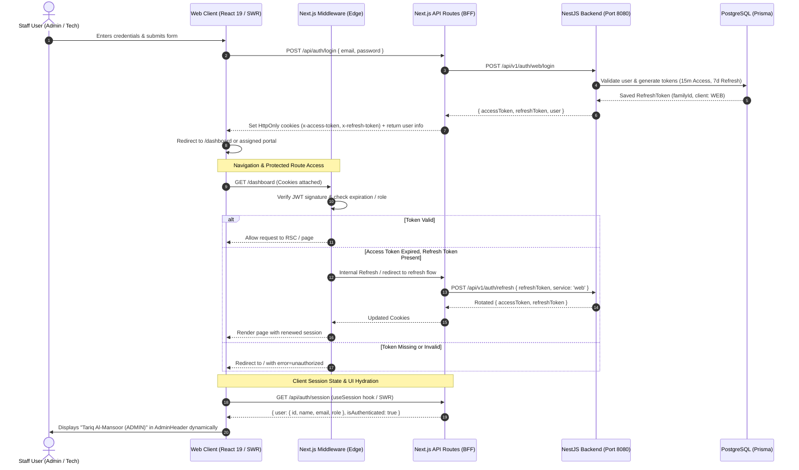

# Session Control Architectural Plan: Self-Creating vs. NextAuth (Auth.js)

## Goal Description

Design and establish a robust, secure, and production-ready session control system for the **FanniTech Web Staff Portal** (`/web`), built with **Next.js 16 (React 19 App Router)** and backed by the authoritative **NestJS Backend** (`/server`).

This document evaluates and contrasts two primary approaches:
1. **Self-Creating Session Control (Custom BFF Pattern with HttpOnly Cookies & JWT)**
2. **Next-Auth (Auth.js v5) with Credentials Provider**

It provides an in-depth comparison across architecture, security, Next.js 16 / React 19 compatibility, developer experience, and maintenance, followed by an end-to-end implementation blueprint for the selected solution incorporating the centralized backend refresh endpoint (`/api/v1/auth/refresh`).

---

## Current State Analysis

### Backend (`/server`)
- Authoritative NestJS authentication service utilizing PostgreSQL and Prisma.
- Centralized auth endpoints under `/api/v1/auth`:
  - `POST /api/v1/auth/web/login` — Authenticates staff with credentials, generates short-lived access token (15 min) and long-lived refresh token (7 days).
  - `POST /api/v1/auth/refresh` — **Centralized refresh endpoint** supporting both `web` and `mobile` services via `{ refreshToken, service: 'web' | 'mobile' }`. Rotates both tokens and updates the Prisma `RefreshToken` database record with token family tracking.
  - `POST /api/v1/auth/logout` — Revokes refresh token in the database.
- Refresh token rotation stores `familyId`, `deviceInfo`, `client: WEB`, and `revoke: boolean` flags for theft detection and immediate revocation.

### Frontend (`/web`)
- **Next.js 16.3.8** with **React 19.2.8** using App Router.
- Current login route (`/api/auth/login`) forwards credentials to `${BACKEND_API_URL}/api/v1/auth/web/login` and sets `x-access-token` and `x-refresh-token` as `HttpOnly, Secure, SameSite=lax` cookies.
- Current `src/middleware.ts` decodes and verifies the `x-access-token` JWT signature via the Web Crypto API (`crypto.subtle`) against `ACCESS_TOKEN_SECRET`, checking expiration and requiring role `ADMIN`.
- **Gaps Addressed in this Plan**:
  - **No Automatic Token Refresh**: When the 15-minute access token expires, requests are rejected and the user is redirected to `/` with `error=session_expired` instead of rotating tokens seamlessly via `/api/v1/auth/refresh`.
  - **No Client Session State / Provider**: Components like `AdminHeader.tsx` hardcode the admin's name and role (`Tariq Al-Mansoor`, `Owner / Admin`) because there is no `useSession()` hook or `/api/auth/session` endpoint.
  - **Role Guard Limitations**: Middleware only permits `ADMIN` and blocks `TECHNICIAN`, even though both staff roles use the portal (`(admin)` and `(technician)` route groups).
  - **No Centralized Session Context**: According to `web/AGENTS.md`, sensitive auth state must **not** be stored in Zustand, meaning a dedicated SWR or React Context session provider is required.

---

## Architectural Comparison: Self-Creating vs NextAuth (Auth.js)

### Comprehensive Comparison Matrix

| Evaluation Dimension | Option A: Self-Creating Session Control (Custom BFF) | Option B: NextAuth / Auth.js (v5) |
| :--- | :--- | :--- |
| **Architectural Fit** | **Native Match**. Direct 1-to-1 alignment with NestJS's token architecture. Next.js acts as a secure BFF handling cookies and proxying to `/api/v1/auth/refresh`. | **Impedance Mismatch**. NextAuth wraps NestJS's tokens inside its own JWE session cookie ("session-inside-a-session"), creating dual state and token bloat. |
| **Backend Token Refresh** | **Clean & Direct**. An internal `/api/auth/refresh` route calls NestJS `POST /api/v1/auth/refresh` with `{ refreshToken, service: 'web' }`, performs family rotation in DB, and rewrites cookies transparently. | **Complex Callback Hacking**. NextAuth does not natively support token refresh for `CredentialsProvider`. Requires complex custom arithmetic inside `jwt()` and `session()` callbacks. |
| **Framework Compatibility** | **100% Compatible**. Built on native Web standard primitives (`Request`, `Response`, `cookies()`, Web Crypto). Immune to framework churn. | **High Risk**. NextAuth v4 does not support React 19. Auth.js v5 is still in beta with documented quirks in Next.js 15/16 App Router and Edge Middleware. |
| **Security Controls** | **Maximum Control**. Direct control over cookie flags (`HttpOnly`, `SameSite=Lax`, `Secure`, `Path`), rotation revocation, and signature validation via Web Crypto. | **Standardized but Opaque**. Relies on NextAuth default cookie and encryption handling; debugging token lifecycle issues across boundaries is complex. |
| **Compliance with Project Rules** | **Full Compliance**. Adheres to `web/AGENTS.md` (no Zustand for auth, business logic in `services/`, API routes in `api/`, SWR data fetching). | **Partial**. Overrides standard Next.js route structures with NextAuth conventions (`/api/auth/[...nextauth]`) and custom abstractions. |
| **External Dependencies** | **Zero new dependencies** (leverages native `fetch`, `cookies()`, and Web Crypto). | **Heavy dependencies** (`next-auth@beta`, `@auth/core`). |
| **Maintenance Burden** | **Low to Medium**. Needs maintaining ~4 concise files (`middleware.ts`, `session/route.ts`, `refresh/route.ts`, `SessionContext.tsx`). | **High**. Constantly maintaining workarounds for `CredentialsProvider` token refresh and beta version updates. |

---

## Architectural Decision & Recommendation

> [!IMPORTANT]
> **Chosen Approach: Self-Creating Session Control (Custom BFF Pattern)**
> 
> Because FanniTech's backend is a dedicated NestJS API that serves both Mobile and Web clients with central DB token tracking and a centralized `/api/v1/auth/refresh` endpoint, introducing NextAuth adds a redundant abstraction layer that complicates token refresh rotation without adding value (since third-party OAuth/social providers are not used for internal staff).
> 
> Self-creating session control provides full transparency, optimal performance on React 19 / Next.js 16, and direct adherence to FanniTech's architectural rules.

---

## Confirmed Technical Decisions

> [!NOTE]
> ### 1. Centralized Refresh Route
> The backend refresh endpoint is confirmed as `POST /api/v1/auth/refresh`, accepting `{ refreshToken: string, service: 'mobile' | 'web' }`. The web BFF dispatches refresh requests with `service: 'web'`.

> [!NOTE]
> ### 2. Session Context Strategy (Zero Zustand)
> In strict compliance with `web/AGENTS.md` (*"DO NOT make authentication store managed by zustand because it is a sensitive data"*), the client session will be exposed via a lightweight React Context (`SessionProvider` + `useSession()`) backed by `swr` for background revalidation and automatic logout propagation across tabs.

---

## End-to-End Architecture: Self-Creating Session Control



---

## Detailed Implementation Plan

### Component 1: Next.js API Route Handlers (BFF Layer)

#### [NEW] `web/src/app/api/auth/session/route.ts`
Returns the currently authenticated user's profile and session validity to Client Components:
- Reads `x-access-token` from cookies.
- Verifies signature against `ACCESS_TOKEN_SECRET`.
- If expired but `x-refresh-token` exists, transparently calls the centralized backend `/api/v1/auth/refresh` endpoint with `service: 'web'` and updates the response cookies.
- Returns `{ user, isAuthenticated: true }` or `{ user: null, isAuthenticated: false }`.

#### [NEW] `web/src/app/api/auth/refresh/route.ts`
Explicit refresh endpoint called by client or API interceptors:
- Reads `x-refresh-token` from cookies.
- Calls NestJS `${BACKEND_API_URL}/api/v1/auth/refresh` with `{ refreshToken, service: 'web' }`.
- Sets new rotated cookies (`x-access-token` 15 min, `x-refresh-token` 7 days).
- Returns updated token status.

#### [MODIFY] `web/src/app/api/auth/login/route.ts`
- Ensure strict cookie options (`httpOnly: true`, `sameSite: 'lax'`, `path: '/'`, `secure: process.env.NODE_ENV === 'production'`).
- Ensure consistent response shape matching `LoginResponse`.

#### [MODIFY] `web/src/app/api/auth/logout/route.ts`
- Read `x-refresh-token` cookie and forward to NestJS backend `POST /api/v1/auth/logout` to revoke token family in PostgreSQL.
- Expire both `x-access-token` and `x-refresh-token` cookies with `maxAge: 0`.

---

### Component 2: Next.js Edge Middleware & Route Guards

#### [MODIFY] `web/src/middleware.ts`
Upgrade middleware to handle multi-role staff portal routing:
- Support both `ADMIN` and `TECHNICIAN` roles:
  - Admin paths (`/dashboard`, `/customers`, `/repair-tickets`, `/technicians`, `/reports`, `/settings`) require role `ADMIN`.
  - Technician paths (`/technician/:path*`, `/bench/:path*`) require role `TECHNICIAN` or `ADMIN`.
- When `x-access-token` is expired but `x-refresh-token` is present:
  - Call the centralized backend refresh endpoint or redirect to an internal `/api/auth/refresh?redirect=${pathname}` cycle that renews cookies and resumes navigation seamlessly without kicking the user out every 15 minutes.

---

### Component 3: Client-Side Session Provider & Hooks

#### [NEW] `web/src/components/Providers/SessionProvider.tsx`
- React Context wrapping the application in `layout.tsx`.
- Uses SWR (`useSWR('/api/auth/session')`) for stale-while-revalidate session caching, background refetching on window focus, and cross-tab synchronization.
- Exposes `useSession()` returning `{ user, role, isLoading, isAuthenticated, refreshSession, logout }`.

#### [MODIFY] `web/src/components/AdminDashboard/AdminHeader.tsx`
- Replace hardcoded user name ("Tariq Al-Mansoor") with real user info from `useSession()`.
- Display dynamic initials and role badge.

#### [MODIFY] `web/src/components/AdminDashboard/AdminSidebar.tsx`
- Connect logout action to `useSession().logout()` for clean redirect and cache clearance.

---

## Verification Plan

### Automated Checks
- Run TypeScript type checks across `web`:
  ```bash
  npm --prefix web run type-check
  ```
- Run ESLint to verify code standards:
  ```bash
  npm --prefix web run lint
  ```
- Build Next.js application to verify SSR/RSC build sanity:
  ```bash
  npm --prefix web run build
  ```

### Manual Verification
1. **Login Flow**: Sign in at `http://localhost:3000` with admin credentials (`admin@fannitech.com`). Verify cookies `x-access-token` and `x-refresh-token` are set as `HttpOnly`.
2. **Role Guard**: Verify access to `/dashboard` succeeds for `ADMIN` and redirects unauthorized users.
3. **Dynamic User Header**: Confirm `AdminHeader.tsx` renders the logged-in user's actual name, initials, and role.
4. **Session Persistence**: Refresh the browser page on `/dashboard`; verify session persists without flickering.
5. **Token Refresh**: Fast-forward/simulate an expired access token; verify the session automatically refreshes via `POST /api/v1/auth/refresh { service: 'web' }` without forcing a manual re-login.
6. **Logout**: Click Logout in `AdminSidebar.tsx`; verify backend token is revoked, cookies are deleted, and user is redirected to `/`.
